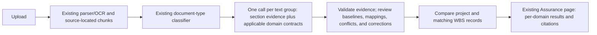
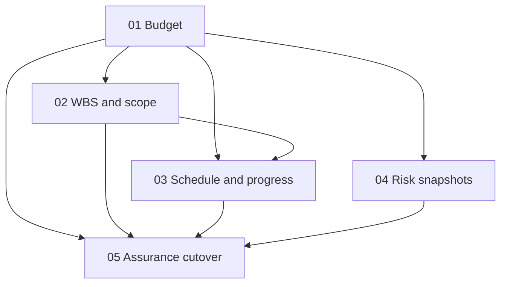

# PMO Assurance Pipeline — Handoff

This README orients the next agent to the approved PMO assurance design and its five tickets. It describes the current repo and intended change; the new domain-contract pipeline is not implemented yet. The glossary and ADRs linked below are the source of truth if this summary conflicts with them.

## Current situation

The product is a Next.js/Supabase project-assurance app. Evidence upload creates `ai_jobs`; n8n orchestrates processing and calls the Next.js worker at `/api/workers/parse-document`. The worker parses supported documents, creates source-mapped chunks, and returns generic facts and summaries/health/alert/action signals. The root [README](../../README.md) describes supported files, development setup, and the current configured-provider example. Actual deployed n8n workflows, secrets, and runtime provider settings have not been verified from this repo.

The root README lists PDF, TXT, CSV, DOCX, XLSX, PPTX, and common raster images as supported; legacy `.ppt` may be retained but is not automatically parsed. It documents local Tesseract/Ghostscript OCR and an Ollama Cloud development example. Treat these as documented setup, not proof of the live runtime configuration.

The current assurance path also reads evidence and evaluates Budget, Schedule, and Risk. The classifier currently assigns one primary document type/role, while extraction is not expressed as the PMO domain contracts in this plan. The existing Budget evaluator currently uses `currentForecast ?? currentActual`; see [`evaluateBudget`](../../src/features/assurance/lib/analysis.ts#L161-L164). That means actual cost can be compared when forecast is absent. Ticket 01 must change that behavior: missing EAC is an evidence gap, never a substitute comparison against actual cost.

The existing upload/parser/chunk/source-location path is intentionally reused. This work replaces the assurance-specific extraction and results, not the whole ingestion stack. It does not create a permanent parallel parser or Assurance pipeline.

## Desired state

A source document can contribute evidence to several PMO domains, regardless of its primary type. Keep the existing document-level classifier. For each existing text group, use one structured model call to identify relevant section/domain evidence and extract all applicable contracts together. Do not add a separate section-classification call or one model call per domain. The model/provider is not selected; the target is a free provider. If its quota is reached, defer remaining groups and retry later; keep them marked not processed until completed.

### Contract boundaries

- **Cost:** keep approved baseline, actual-to-date, committed cost, and explicitly reported EAC separate at project/WBS level when available. Compare baseline with EAC only. No monthly phasing. Compare only equal currencies; no FX conversion. Budget thresholds apply only to comparable evidence: variance `<= 0%` on track, `> 0%` through `5%` needs attention, and `> 5%` critical.
- **Schedule and progress:** compare an approved baseline date with an explicitly reported forecast date for the same milestone/work package. Progress percentages remain as reported; do not calculate a project total from WBS percentages or infer a forecast date. Schedule thresholds for comparable dates: `0` days late on track, `1–14` needs attention, and `> 14` critical.
- **WBS and scope:** minimum identity is source/canonical code, parent code when present, name, and stated deliverable/scope. A differing WBS or milestone label is a source-backed proposal; a reviewer must accept the mapping before comparison/reuse. Show scope differences as candidates, not approved changes. Missing WBS detail does not suppress a supported project-total result.
- **Risk:** retain item snapshots by reporting period, including source ID/name, description, status, original rating scale, owner, mitigation, due date, and WBS when stated. Mark a risk new/increased only with a comparable earlier snapshot and exact ID or a reviewer-accepted identity mapping. Compare different rating scales only after an accepted scale mapping. Do not create a calculated project Risk score.
- **Evidence and approval:** every observation keeps source wording/value and exact location; safe normalized values supplement it. A reviewer may correct the value used in assessment without rewriting source evidence. Baselines are accepted by an authorized reviewer per domain, scope, and effective date; the document's own “approved” label does not activate one. Change statements in documents are evidence only and never update a baseline automatically. Missing, unprocessed, ambiguous, and conflicting evidence are distinct from zero.
- **Result:** show evidence-backed Budget, Schedule, and Risk statuses separately, with project/WBS findings, scope differences, gaps, and citations on the existing Assurance page. No composite score, AI-generated action suggestions, or new downloadable report.

## Document and domain vocabulary

Use [`CONTEXT.md`](../../CONTEXT.md) as the full glossary. Key terms for these tickets:

| Term | Meaning in this work |
| --- | --- |
| Source document | An uploaded project artifact; format/layout may vary and one file may support several domains. |
| Document type | Context about an artifact's purpose (for example, baseline or finance report); not an exclusive extraction schema. |
| Section classification | Context for a section/table; it supplements the document type and does not gate clear evidence. |
| Evidence contract | A predefined structure for a PMO domain such as cost, schedule, WBS/progress, or risk. |
| Baseline candidate | Source-backed comparison values awaiting reviewer acceptance for domain, scope, and effective date. |
| Baseline | The reviewer-accepted comparison reference. A source file's label alone does not approve it. |
| Evidence observation | A value/claim with original wording/value, safe normalized value when available, meaning, units, scope, period/status, and exact source location. |
| Evidence gap | Missing, unprocessed, ambiguous, conflicting, or incomparable required evidence. It is not zero. |
| Actual / committed / EAC | Incurred cost / contractually committed cost / reported total cost forecast at completion. Actual and committed do not replace EAC. |
| WBS record | Work-package code, parent when present, name, and stated deliverable/scope. |
| Reported forecast | A future amount/date explicitly present in a source; the pipeline does not generate a prediction. |
| Progress record | An explicitly reported project/WBS percentage with its source period/as-of date; never an inferred forecast. |
| Risk snapshot | Item-level risk claims for a stated reporting period, retaining its source rating and scale. |
| Supporting source | Evidence for a field (for example, a purchase order supporting committed cost) without turning the entire subject into a new domain. |

The source documents that may contain these values are not fixed templates. A baseline document can contain cost, dates, scope, or risks; finance reports can contain WBS mappings; meeting minutes/change records can state proposed/approved/rejected decisions; purchase orders may support committed cost. Classify the evidence found, not just the filename or primary document label.

## Tickets and execution order

Each ticket is a vertical slice with its own acceptance criteria. The ticket files—not this summary—define the exact delivery scope:

- [01 — Project-Level Budget Assurance](issues/01-project-budget-assurance.md)
- [02 — WBS Cost and Scope Comparison](issues/02-wbs-scope-comparison.md)
- [03 — Schedule and Progress Assurance](issues/03-schedule-progress-assurance.md)
- [04 — Risk Snapshot Comparison](issues/04-risk-snapshot-comparison.md)
- [05 — Cut Over Assurance to Evidence-Backed Results](issues/05-assurance-cutover.md)

Start with ticket 01. Once it is resolved, tickets 02 and 04 can proceed; ticket 03 waits for both 01 and 02; ticket 05 waits for all four domain slices. Do not start a ticket while any listed blocker remains unresolved.

For each ticket:

1. Read root [`AGENTS.md`](../../AGENTS.md), [`docs/agents/issue-tracker.md`](../../docs/agents/issue-tracker.md), [`docs/agents/domain.md`](../../docs/agents/domain.md), [`CONTEXT.md`](../../CONTEXT.md), and the relevant ADRs before editing.
2. Read the ticket and its blockers. Claim it by changing `Status: ready-for-agent` to `Status: claimed` before implementation.
3. Deliver the complete path described by the ticket across persistence, worker/API, Assurance UI, and verification. Keep original evidence/source locations; do not replace missing forecasts with actuals or silently drop incomplete groups.
4. Run the relevant tests and a specific upload-to-Assurance smoke scenario. Record what passed, what changed, and any limitation in the ticket's `## Comments` section.
5. Set `Status: resolved` only when every acceptance criterion is satisfied and the verification evidence is recorded.

## Source of truth and boundaries

- [`CONTEXT.md`](../../CONTEXT.md) owns the glossary and agreed evidence rules.
- [`docs/adr/`](../../docs/adr/) records the design decisions: contracts independent of document type, reviewer-approved baselines, project/WBS comparisons, accepted identity mappings, field-specific source authority, and reuse of the current parser.
- The five ticket files own implementation scope, acceptance criteria, and blockers.
- The root [README](../../README.md) describes the current app/setup; its provider example is not the final model choice for this pipeline.

Do not expand this work into full procurement tracking, generated cost/schedule predictions, cross-currency conversion, a composite project score, AI action recommendations, or a separate report export. Preserve unrelated document-summary and Advisor behavior during Assurance cutover.
