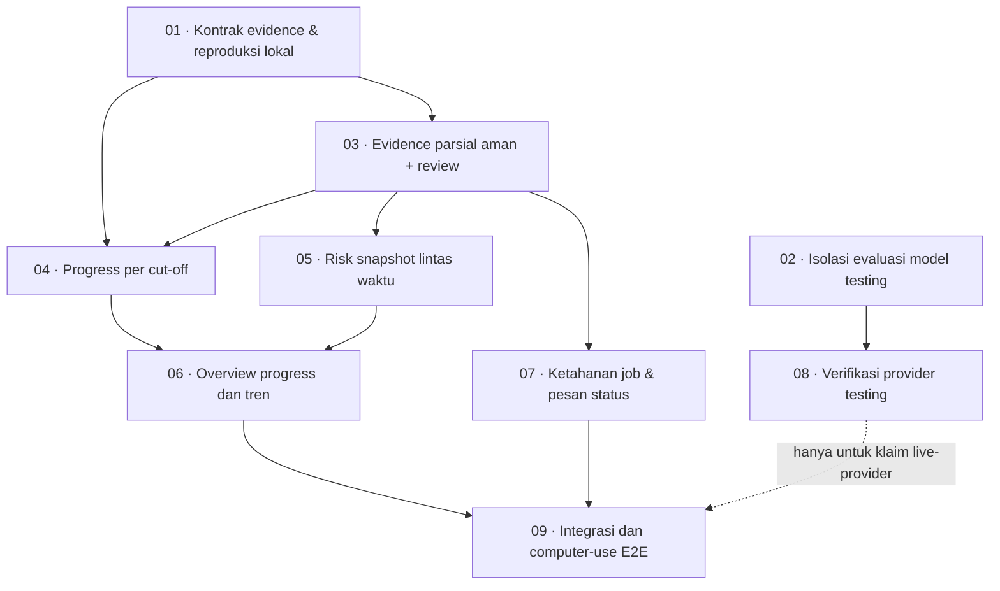

# Rencana orkestrasi — evidence PMO hingga kesehatan proyek

Status: pembagian slice dan dependensi disetujui; [tiket implementasi](issues/) telah diterbitkan. Keputusan yang masih terbuka dan izin pengujian live tetap berlaku. Baseline integrasi: `master` fork `ibayyabi/DevXassurance`, merge `695ce52`.

## Tujuan dan keputusan yang disepakati

- PMO mengunggah dokumen proyek yang bervariasi; sistem menampilkan progress sebagai kondisi tersendiri di samping Budget, Schedule, dan Risk, dengan sumber dan perubahan per cut-off.
- Observasi jelas dan tervalidasi dapat ditampilkan meskipun dokumen `needs_review`; baseline, mapping, konflik, dan nilai ambigu tetap memerlukan keputusan reviewer. Status pemrosesan dokumen bukan kualitas atau kelengkapan assurance.
- RAG progress yang dilaporkan sumber ditampilkan sebagai klaim bersitasi, terpisah dari status hitungan. Status hitungan hanya menggunakan aturan proyek yang disetujui dan berversi; tanpa aturan yang berlaku, nilai tetap terlihat tetapi status belum dinilai. Ambang fixture bukan default global.
- LLM aplikasi production tetap Ollama Cloud `gpt-oss:20b`; jangan mengubah provider/model production, menambah fallback otomatis, atau menjadikan DeepSeek/Qwen sebagai LLM aplikasi. DeepSeek via commandcode dapat dipakai sebagai subagent engineering.
- Model lain hanya boleh dievaluasi sebagai alat **testing** pada environment terisolasi, tidak menulis konfigurasi production atau data proyek pengguna. Belum ada model pengujian yang dipilih atau tervalidasi.
- Tidak ada spam provider: default 0 panggilan live. Uji otomatis deterministik memakai fixture/respons rekaman tersanitasi atau server fixture yang sudah ada; bukan bukti kualitas model. Setiap pengujian model riil butuh persetujuan eksplisit user dengan jumlah maksimum request, estimasi biaya, isi yang dikirim, serta kebijakan privasi. Hentikan saat 429/402/error berulang; jangan retry massal.
- Tidak ada formula engine atau LLM yang mengarang hasil formula. Data belum diproses, tidak tersedia, ambigu, bertentangan, dan nol adalah keadaan berbeda. Bukti per sel harus menyimpan nilai asli, satuan, periode, scope, dan provenance; cached formula bukan bukti freshness.
- Approved baseline untuk rencana berbeda dari previous snapshot untuk perbandingan progres/risiko. Jangan memperlakukan actual/committed sebagai EAC atau progress sebagai forecast tanggal. Jangan membuat skor risiko/composite keseluruhan tanpa keputusan produk baru.
- `CONTEXT.md` dan `docs/adr/` adalah kontrak yang perlu dihormati; perbarui glossary/ADR hanya bila keputusan baru sudah jelas. Jangan edit/menutup tiket PMO lama secara diam-diam; cek status dan blocker yang aktual sebelum menghubungkan slice, terutama issue 04 risk.

## Dasar diagnosis dan bukti

- Fixture: `demo-evidence-fixtures/smart-building-itb/README.md` dan `expected-results.json` (oracle pembanding, jangan diunggah). W4/W5 Alarm menyatakan actual 12,50% → 20,40%; W5 mengandung `R-SB01-001` dan `R-SB01-002`. Bandingkan tanggal sumber, nilai, skala, scope, dan lokasi—jangan hanya warna.
- Investigasi proyek `E2E testing building smart` menemukan laporan W4/W5 berisi progress, namun observasi progress/risk kedua workbook tidak tersimpan; coverage berbagai grup `unprocessed`/ambigu. Cost observations/baselines 0; satu job failed dengan `stale_claim_token`. Review yang dibuat 16 November bukan 16 Oktober. Kondisi database ini adalah snapshot, bukan jaminan kondisi saat implementasi.
- Parser per-sel dan tanggal cut-off sudah ada di baseline integrasi; kesesuaiannya secara end-to-end belum dibuktikan. Perubahan tersebut tidak menjamin LLM memilih source ID tepat atau menghubungkan nilai dan konteks tanggal/scope dalam sel berbeda. Review keamanan dan regresi perubahan yang sudah ada sebelum membangun di atasnya.
- `worker/README.md`, `.scratch/pmo-assurance-pipeline/README.md`, `docs/agents/README.md` dan `docs/adr/` adalah rujukan; beberapa dokumen lama menyebut model/provider belum dipilih. Constraint baru di atas menggantikannya untuk pekerjaan ini. `.scratch/llm-model-research/research.md` adalah riset historis, bukan bukti kemampuan atau rekomendasi mengganti production.

## Kontrak integrasi lintas slice

1. **Evidence:** observasi yang digunakan memiliki file/versi, lokasi sumber, nilai asli, nilai normalisasi jika aman, jenis pengukuran, scope dan waktu. Jangan mengambil konteks tanggal/scope dari sel lain tanpa relasi baris/header yang terbukti. Jika provenance tidak cukup, tampilkan gap.
2. **Coverage:** coverage domain/grup yang belum lengkap tetap terbuka. Observasi valid parsial tetap terlihat sebagai evidence dengan peringatan; satu observasi tidak membuktikan domain penuh. `unprocessed` tidak boleh diubah menjadi `absent`, hijau, atau nol. Domain lain yang didukung tidak boleh diturunkan hanya karena dokumen lain bermasalah tanpa alasan relevan.
3. **Waktu:** review baru memakai cut-off; review bulanan lama tetap semantik month-end. Metadata dokumen yang hanya menyatakan bulan tidak membuktikan tanggal mingguan. Identik filename + isi berbeda = dokumen/snapshot berbeda. Jangan diam-diam mencampur evidence lintas cut-off.
4. **Progress vs Schedule:** progress terpisah dari Schedule; planned vs actual untuk scope/periode yang sama dan dalam satuan sebanding. Nilai pecahan XLSX hanya dikonversi jika format/sumber mendukung. Pertahankan RAG sumber dan status hitungan terpisah; hitung hanya dengan aturan proyek yang disetujui dan berversi, jika tidak ada tampilkan belum dinilai.
5. **Risk:** cocokkan ID persis atau mapping yang disetujui, dengan periode dan skala; ketiadaan observasi tidak membuktikan risk closed. Previous snapshot berbeda dari approved baseline.
6. **Keamanan operasional:** semua observasi dan sumber milik project, service-role tidak di client, RLS dan claim-token/fencing dipertahankan. Tidak melakukan mutasi Supabase hosted/deployment/migrasi tanpa izin terpisah.

## Graf kerja: satu integration owner, frontier berbasis dependensi

### 01 — Kontrak evidence dan reproduksi lokal — blocker: tidak ada

**Owner:** agent engineering DeepSeek; integrator memiliki skema/kontrak bersama.
**Hasil:** replay terisolasi dari kasus W4/W5 yang menguji alur parser → respons terkontrol → validator → persistence/hasil tanpa live model. Periksa apakah referensi per-sel mempertahankan relasi periode, scope dan unit pada baris sama; audit juga pemulihan lokasi saat cache hit dan provenance tersimpan.
**Penerimaan:** contoh literal terdukung diterima dengan lokasi tepat; formula unresolved tidak menghasilkan nilai; konteks lintas sel tanpa bukti ditolak/gap; contoh nilai ambigu, source ID palsu, cut-off salah, dan source cache versi lama tidak lolos. Kasus negatif deterministic dan verifikasi lintas versi/parser harus gagal bila guard dilemahkan.

### 02 — Isolasi model pengujian — blocker: tidak ada

**Owner:** agent evaluasi read-only; tidak mengubah source/config production. 
**Hasil:** pilih kandidat testing dari provider yang sudah terintegrasi atau model lokal yang benar-benar tersedia; verifikasi API JSON, konteks, rate limit, biaya, lisensi, kebijakan data, hardware dan response-shape dari sumber primer saat evaluasi. Identifikasi apakah model boleh menerima fixture (fixture bukan izin otomatis untuk mengirim data riil). Catat mismatch antar konfigurasi model di handoff lama, jangan mengubah production berdasarkan itu.
**Penerimaan:** pilihan diberi alasan dan bukti, pin model/version, konfigurasi test terpisah, budget hard cap eksplisit, fallback disabled, langkah rollback; belum menjalankan request live tanpa izin. Jika belum ada kandidat/akses, tandai blocked, lanjutkan semua pengujian deterministik lain.

### 03 — Evidence parsial dan review — blocker: 01

**Owner:** satu agent menguasai worker/persistensi/assurance coverage dan UI review; jangan paralel menulis file yang sama.
**Hasil:** observasi valid parsial tetap dapat diperiksa dan, jika memenuhi kontrak, dipakai tanpa menyembunyikan batas sumber. `needs_review` dapat dipilih bila coverage versi sumber tersedia; reviewer dapat menerima/mengoreksi/menolak item yang didukung. Warning dan gap tetap terlihat saat status dokumen berubah.
**Penerimaan:** dokumen campuran yang memuat satu nilai jelas dan satu formula tidak tersedia menampilkan nilai ber-sumber serta gap spesifik; hasil tidak memalsukan `processed` total. Tidak ada bulk accept diam-diam, tidak ada nol/hijau dari gap, source/correction tetap terjaga. Buktikan lewat antarmuka dan pemeriksaan role/version pada DB test lokal.

### 04 — Progress per cut-off — blocker: 01, 03

**Owner:** satu agent memiliki model progress/comparator dan API; koordinasi kontrak UI dengan owner 06.
**Hasil:** planned/actual source-backed per komponen dan tanggal, snapshot sebelumnya terpisah dari approved baseline; tampilkan perubahan hanya jika scope/unit/periode terbukti sebanding.
**Penerimaan:** W4/W5 SB01 12,50% → 20,40%, delta +7,90 pp, dengan sumber kedua cut-off. Test identik filename, data unit ambigu, metadata bulan saja, konflik, missing W4/W5, dan data masa depan; semua hasil ambigu/gap tanpa perubahan diam-diam. Perhitungan planned/actual dan status harus menggunakan aturan yang disetujui dan berversi.

### 05 — Risk snapshot — blocker: 03; gunakan kontrak identitas dan periode dari 01

**Owner:** satu agent memiliki risk comparator/panel; telusuri implementasi dan ticket 04 yang sudah ada sebelum mengubah. 
**Hasil:** risk per periode, previous snapshot terpisah dari baseline proyek, temuan new/closed/increased hanya bila pembanding comparable.
**Penerimaan:** risk W5 Alarm 001/002 ditampilkan dengan sumber jika tersedia; kasus W6/W7 sesuai expected-results bila seluruh sumber dan identity tersedia; gap bila tidak ada sebelumnya, ID tidak cocok, skala berbeda tanpa mapping, atau dokumen belum diproses. Tidak ada inferred closed dari evidence yang hilang.

**Ticket 05 → 06 status/provenance handoff (claimed; deterministic tests authored, not run):**
- Read `risk_item_findings[]` with `previous`/`current` snapshots and `changeType`; citations carry document ID/title, content hash, excerpt, source location, cutoff, and reviewer decision/source values.
- `risk_comparison_provenance` identifies contract `pmo_risk_comparison_v2`, mapping `referenceFingerprint`/versions, selected earlier review, source versions, decision summary, and coverage/cutoff completeness.
- Previous evidence is the nearest earlier completed review's project-scoped `current` role, never the approved baseline; only version-matched observations and decisions participate.
- Missing prior review, incomplete coverage, absent/ambiguous/conflicting cutoffs, or unknown identity/scale must remain visible gaps; no inferred closure or composite Risk score.
- W5 Alarm IDs and W6 changes are shown only from validated cited source rows; do not claim W7 outcomes absent validated source evidence.

### 06 — Overview dan navigasi review — blocker: 04, 05

**Owner:** satu agent frontend, integrator menetapkan read model bersama.
**Hasil:** tampilkan Progress, Budget, Schedule, Risk secara terpisah; status, cut-off, perubahan, provenance, dan alasan gap. Navigasi W4–W7, pilih evidence secara eksplisit; peringatan jika periode tidak cocok atau tidak diketahui.
**Penerimaan:** chart tidak membuat nol/hijau untuk gap; W4/W5 dapat dibedakan pada nama file sama; reviewer melihat evidence parsial dan ketidakpastian; tampilan responsive, keyboard/focus/nama kontrol diperiksa via browser. Perbedaan source-reported RAG dan computed condition dijelaskan. Tidak ada agregasi lintas scope/score proyek yang tidak disetujui.

### 07 — Ketahanan job dan pesan status — blocker: 03

**Owner:** agent worker/n8n; hindari file yang masih ditulis owner 03.
**Hasil:** diagnosis claim/lease `stale_claim_token`, pemulihan ownership aman dan pesan UI yang membedakan failed, queued, processing, needs_review dan completed.
**Penerimaan:** job kehilangan lease tidak menimpa hasil baru atau menggandakan pekerjaan; 429/deferred tidak dihitung absent dan checkpoint yang valid dipakai ulang; tidak ada retry loop yang menghabiskan quota. Verifikasi lewat simulated lease/clock, tanpa cloud.

### 08 — Verifikasi kandidat model testing — blocker: 02; butuh persetujuan eksplisit user

**Owner:** satu agent pengujian; model testing adalah alat test, bukan production. 
**Hasil:** satu skenario kecil sintetis/non-sensitive, maksimal request yang diizinkan user, konfigurasi dan database benar-benar terpisah, setiap request dicatat. Berhenti pada batas, 429/402, atau ketidakpastian biaya.
**Penerimaan:** JSON, citation IDs, bahasa Indonesia, unit/tanggal, outcome dan retry diperiksa terhadap fixture; catat model/version, jumlah panggilan, latency dan limitation. Hasil model pengujian tidak membuktikan `gpt-oss:20b` production setara. Jika user belum menyetujui, status blocked; jangan panggil provider.

### 09 — Integrasi dan computer-use E2E — blocker: 04, 05, 06, 07; 08 hanya untuk klaim live-provider

**Owner:** integrator/agent computer-use. Jalankan satu kali setelah wave selesai; gunakan database/proyek test baru dan role reviewer, bukan memodifikasi proyek pengguna. Periksa migrasi/version target sebelum deploy dan jangan push tanpa izin.
**Penerimaan:** baseline → W4 → `needs_review`/review terarah → assessment → W5 file bernama sama → review/assurance → Overview, lalu W6/W7 bila user menyetujui kapasitas. Gunakan `expected-results.json` sebagai oracle, bukan upload. Catat PASS/FAIL/BLOCKED/DATA GAP, screenshot, sumber, request count. Tidak terima semua fakta buta, tidak masukkan nilai manual untuk lulus. Kepastian sistem end-to-end hanya boleh diklaim untuk skenario dan model yang benar-benar dijalankan.

## Strategi orkestrasi dan integrasi

- Orkestrator bertanggung jawab atas keputusan dan satu integration branch dari fork master; agen implementasi bekerja pada worktree/cabang terpisah dan menyebut file yang dipegang. Jangan serentak mengedit migration, kontrak worker, atau read model yang sama. Jika worktree membutuhkan perubahan pengguna yang belum dikomit, hentikan dan komunikasikan—jangan stash/reset perubahan pengguna.
- Wave 1: 01 dan 02 paralel. Wave 2: 03 setelah 01. Wave 3: 04 dan 07 setelah blocker; 05 setelah kontrak identitas/waktu jelas. Wave 4: 06 setelah 04/05. Wave akhir: integrasi dan 09. 08 hanya setelah persetujuan live; ketiadaannya tidak menghalangi seluruh validasi offline.
- Setiap agent menerima referensi plan, objective, batasan LLM/privasi, file ownership, observable acceptance, dan diminta tidak menjalankan build/lint/tests/formatters di tengah pekerjaan. Integrator menggabungkan, menjalankan satu set verifikasi terarah setelah wave, serta smoke di jalur nyata. Agent melaporkan perubahan, asumsi, risiko dan perintah yang belum dijalankan.
- Gunakan test perilaku deterministik pada seam tertinggi: unggah/worker → hasil validasi → hasil assurance/Overview; fixture provider mensimulasikan output tidak valid, quota 429, evidence parsial dan versi. Hindari test wiring, copy, incidental wording, atau sekadar not-throw.
- Jangan mengirim 56 file ke provider untuk mencari penyebab. Mulai dari satu workbook W4 dan satu W5 hanya setelah ada anggaran live yang disetujui; unggahan penuh adalah keputusan user terpisah. Model test berbeda boleh menguji integrasi, tetapi final sign-off terhadap model production tetap perlu validasi terbatas `gpt-oss:20b` atas izin user.

## Keputusan yang masih terbuka

1. Rollup project dari WBS tetap dilarang oleh kontrak saat ini; perubahan kebijakan dan bobot membutuhkan keputusan domain baru.
2. Provider/model testing, izin data, lingkungan terisolasi, dan batas absolut request/biaya; belum ada yang dipilih.
3. Kapan mengizinkan satu live smoke pada `gpt-oss:20b` production-like; default tidak ada panggilan sampai user memberi izin.

Tiket dengan keputusan yang belum tersedia ditandai `needs-info`; persetujuan rencana bukan izin menjalankan provider live. Rencana ini bukan klaim implementasi sudah selesai.
