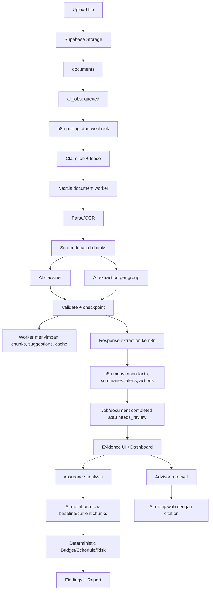

# Pipeline n8n, Worker, dan AI X-Assurance

Dokumen ini menjelaskan cara kerja pipeline yang saat ini ada di repository, batas ownership setiap komponen, serta perbedaan penting terhadap target pada `evidence-normalization-and-baseline-prd.md` dan `llm-model-selection-research.md`.

## Kesimpulan utama

Sistem saat ini belum memiliki satu canonical evidence pipeline. Ada satu pipeline ingestion melalui n8n dan worker, tetapi Assurance, Dashboard, Report, dan Advisor masih mengonsumsi jalur data yang berbeda.

Pipeline utama saat ini:



## 1. Intake dan pembuatan job

Browser mengunggah file ke Supabase Storage melalui jalur upload aplikasi. Setelah upload selesai, API:

1. Memverifikasi file benar-benar ada di Storage.
2. Memverifikasi ukuran, tipe, dan project scope.
3. Membuat row `documents`.
4. Membuat row `ai_jobs` dengan `job_type = parse_document` dan `status = queued` untuk file yang dapat diproses.
5. Menjaga lineage melalui `document_upload_submissions` untuk batch atau ZIP.

File yang aman tetapi belum didukung parser disimpan sebagai evidence reference dengan state `needs_review`, bukan dianggap berhasil dianalisis.

Entitas utama:

- `documents`: metadata dan state dokumen.
- `ai_jobs`: state eksekusi background job.
- `document_upload_submissions`: lineage batch/upload/ZIP.
- Supabase Storage: file asli.

`ai_jobs.status` adalah state eksekusi. Status ini tidak sama dengan kelengkapan evidence atau kondisi bisnis proyek.

Sumber utama: `src/app/api/projects/[projectId]/documents/upload/route.ts`.

## 2. Pipeline n8n

Repository memiliki dua mode n8n:

1. `workflows/n8n/x-assurance-supabase-document-processing.json`
   - Mode webhook.
   - Supabase Database Webhook mengirim job baru ke n8n.
2. `workflows/n8n/x-assurance-supabase-document-polling.json`
   - Mode polling.
   - n8n mengambil job dari Supabase secara berkala.

Hanya satu mode seharusnya aktif. Keberadaan dua file di repository tidak membuktikan mode mana yang benar-benar deployed.

### 2.1 Polling mode

Workflow polling saat ini melakukan:

1. Trigger setiap 60 detik.
2. Memanggil RPC `claim_next_available_document_job()`.
3. RPC melakukan lock kapasitas, memulihkan job dengan lease kadaluarsa, membatasi maksimal dua job aktif, dan memilih satu job `queued`.
4. Job diubah menjadi `processing`, `attempt_count` dinaikkan, dan lease 15 menit diberikan.
5. Dokumen terkait diubah menjadi `processing`.
6. n8n memanggil `reset_document_job_results`.
7. n8n membaca metadata dokumen.
8. n8n memanggil endpoint worker:

```text
POST /api/workers/parse-document
```

9. Setelah worker selesai, n8n membaca chunks yang dipersist worker dan menulis hasil turunan ke Supabase.
10. n8n menyelesaikan extraction run, job, dan document state.

Request ke worker membawa metadata seperti:

```json
{
  "job_id": "...",
  "project_id": "...",
  "document_id": "...",
  "storage_bucket": "project-evidence",
  "storage_path": "...",
  "title": "...",
  "file_name": "..."
}
```

n8n tidak mengirim seluruh file atau seluruh corpus ke model. Worker mengambil file dari Storage.

### 2.2 Webhook mode

Webhook mode memiliki alur:

```text
Supabase INSERT ai_jobs
→ n8n webhook
→ normalisasi payload
→ cek queued parse job
→ claim job
→ mark document processing
→ call worker
→ persist result
→ complete job/document
```

Mode webhook merupakan jalur lama/alternatif. Ia perlu diaudit saat cutover karena workflow webhook dan polling dapat memiliki writer serta failure behavior yang berbeda.

### 2.3 Batas tanggung jawab n8n

n8n bertanggung jawab atas:

- trigger dan dispatch;
- claim job;
- lease dan recovery melalui backend/RPC;
- memanggil worker;
- memindahkan payload;
- menulis hasil turunan ke Supabase;
- menyelesaikan state job.

n8n tidak seharusnya bertanggung jawab atas:

- menentukan baseline valid;
- menyetujui mapping;
- menghitung Budget/Schedule/Risk;
- menyetujui baseline;
- menjadi system of record;
- membuat keputusan bisnis dari payload AI.

n8n juga tidak memanggil LLM secara langsung pada pipeline dokumen saat ini. Semua panggilan model dilakukan worker atau aplikasi Next.js.

Sumber utama:

- `workflows/n8n/x-assurance-supabase-document-polling.json`
- `workflows/n8n/x-assurance-supabase-document-processing.json`
- `workflows/n8n/document-processing-boundary.md`
- `workflows/n8n/README.md`

## 3. Pipeline worker

Entry point worker adalah:

```text
src/app/api/workers/parse-document/route.ts
```

Endpoint dilindungi `XASS_WORKER_SECRET`.

### 3.1 Validasi dan download

Worker:

1. Memvalidasi secret.
2. Memastikan `job_id`, `project_id`, dan `document_id` tersedia.
3. Membaca dokumen dengan kondisi `document_id + project_id`.
4. Mengunduh file dari Supabase Storage menggunakan service role.
5. Memanggil `processDocumentJob`.

Jika dokumen tidak berada di project yang diminta, worker mengembalikan kegagalan terminal.

### 3.2 Parsing dan OCR

`parseDocumentBuffer()` menangani:

- PDF dengan `pdfjs-dist`;
- DOCX/XLSX/PPTX melalui ZIP/XML;
- CSV/TXT;
- image OCR;
- scanned-PDF OCR melalui Ghostscript + Tesseract.

Parser mempertahankan source location seperti:

- PDF page;
- spreadsheet sheet/row/range;
- PPTX slide;
- section/heading;
- image/page.

Batas penting:

- PDF maksimal 200 halaman;
- maksimal 64.000 karakter per halaman;
- maksimal 320.000 karakter per PDF;
- scanned-PDF OCR maksimal 20 halaman;
- maksimal 32 extraction groups;
- maksimal sekitar 96 parser chunks.

Jika parser gagal, hasil seharusnya gagal, bukan summary sintetis yang tampak sukses.

### 3.3 Keterbatasan OCR

OCR saat ini memiliki beberapa batas:

- OCR berjalan pada halaman PDF yang tidak memiliki text layer tetapi memiliki image operator.
- Mixed page yang sebagian text dan sebagian gambar dapat melewatkan bagian gambar.
- OCR menggunakan Tesseract lokal.
- Default bahasa adalah `eng`; Bahasa Indonesia memerlukan `ind+eng` dan traineddata yang tersedia.
- Raster PDF saat ini memakai 160 DPI.
- Belum ada pembuktian CER/WER, fidelity angka, atau akurasi tabel produksi.

Mengganti model LLM tidak menyelesaikan kehilangan text pada tahap parser/OCR.

Sumber utama: `worker/src/services/document-parser.ts` dan `worker/README.md`.

## 4. AI extraction di worker

### 4.1 R1 — document classification

Worker melakukan satu classifier call tingkat dokumen menggunakan:

- title;
- filename;
- parser metadata;
- sheet names bila ada;
- preview bounded;
- source references terbatas.

Outputnya meliputi:

- suggested document type;
- suggested evidence role;
- classification confidence;
- classification reason;
- source citation;
- quality warning.

Confidence rendah, conflict dengan intake hint, atau citation invalid menyebabkan `needs_review`.

### 4.2 R2 — group extraction

Chunks dibagi menjadi bounded groups:

- maksimal 3 chunks per group;
- maksimal 10.000 karakter per group;
- maksimal 32 groups per dokumen;
- maksimal 2 provider request aktif dalam worker;
- maksimal 2 attempts per group.

Setiap group dikirim ke model dengan source text, source ID, source location, title/filename, intake hints, dan instruksi output.

Output model saat ini meliputi:

- `facts`;
- `summary`;
- `health_snapshots`;
- `alerts`;
- `actions`;
- metadata suggestions.

Fact type saat ini terbatas pada:

```text
risk
issue
milestone
decision
owner_action
```

Ini belum sama dengan evidence contract baru yang memerlukan cost, budget, progress, procurement, scope, dan `relevant_unmapped` sebagai tipe atau observation yang eksplisit.

### 4.3 Validasi worker

Worker melakukan validasi aplikasi terhadap response model:

- JSON harus dapat diparse;
- field wajib harus ada;
- enum harus valid;
- confidence harus berada pada rentang yang benar;
- health status harus konsisten dengan score;
- citation harus menunjuk source ID yang diizinkan;
- jumlah facts/alerts/actions dibatasi;
- source reference harus berasal dari group yang sedang diproses.

Jika invalid, worker melakukan corrective attempt terbatas. Jika tetap gagal, group disimpan sebagai failed dan job menjadi gagal atau `needs_review`, tergantung jalurnya.

Checkpoint menyimpan:

- `content_hash`;
- parser version;
- extraction schema version;
- provider;
- model;
- attempt count;
- group status;
- last error.

### 4.4 Persistensi worker

Worker menyimpan:

- `document_chunks`;
- document suggestions;
- extraction group checkpoints;
- lease renewal;
- retry/failed state melalui RPC.

Worker mengembalikan ke n8n:

- chunks;
- facts;
- summary;
- health snapshots;
- alerts;
- actions;
- suggestions;
- anomalies;
- parser metadata.

Namun facts, summary, evidence links, alerts, actions, dan anomalies masih ditulis oleh n8n pada chain berikutnya.

## 5. Ownership data saat ini

| Output | Writer saat ini |
|---|---|
| Source chunks | Worker |
| Extraction group checkpoints | Worker |
| Document suggestions | Worker |
| Facts | n8n |
| Evidence links | n8n |
| Document summaries | n8n |
| Health snapshots | n8n |
| Alerts/actions/anomalies | n8n |
| Assessment findings | Next.js Assurance action |
| Advisor interactions | Next.js Advisor action |

Pembagian ini membuat pipeline belum memiliki satu pemilik canonical result.

PRD baru meminta worker menjadi pemilik penulisan hasil normalisasi/assessment dan n8n hanya mengorkestrasi. Itu berarti workflow writer dan semua consumer harus dimigrasikan secara eksplisit.

## 6. Provider dan model saat ini

Ada dua adapter AI terpisah.

### Worker adapter

Lokasi: `worker/src/services/document-extraction.ts`.

Provider yang dipahami:

- `ollama`;
- `ollama_cloud`;
- `openai-compatible`.

Default code worker menggunakan local Ollama dengan model default `qwen2.5:3b` bila tidak dikonfigurasi. Dokumentasi deployment menyebut Ollama Cloud dengan `gpt-oss:20b`.

### Application adapter

Lokasi: `src/lib/ai/ollama.ts`.

Adapter ini dipakai oleh Assurance analysis dan Advisor. Provider juga dikontrol oleh environment global.

### Structured output

Request saat ini menggunakan:

- Ollama: `format: "json"`;
- OpenAI-compatible: `response_format: { "type": "json_object" }`.

Ini bukan strict JSON Schema enforcement. Validasi business schema tetap dilakukan aplikasi setelah response diterima.

Implikasi terhadap `llm-model-selection-research.md`:

- mengganti nama model belum cukup;
- worker adapter dan application adapter harus sama-sama dipetakan;
- strict schema provider memerlukan implementasi adapter yang sesuai;
- kemampuan endpoint harus diuji, bukan diasumsikan dari label “OpenAI-compatible”;
- shortlist model belum menjadi keputusan deployment.

## 7. Consumer setelah ingestion

### 7.1 Assurance Review

`runAssuranceAnalysis()` saat ini:

1. Reviewer memilih dokumen baseline dan current.
2. Aplikasi mengambil raw `document_chunks`.
3. Chunks baseline/current diformat ulang.
4. Request dibatasi sekitar 24.000 karakter.
5. Aplikasi melakukan satu panggilan AI baru melalui `runOllamaChat`.
6. AI mengembalikan budget, schedule milestones, risk counts, dan excerpts.
7. Aplikasi memverifikasi excerpt terhadap source chunks.
8. `evaluateAssuranceReview()` menghitung Budget, Schedule, dan Risk secara deterministik.
9. Findings dan actions disimpan.

Assurance saat ini tidak menggunakan facts/summary hasil worker sebagai canonical input. Ia membaca ulang raw chunks dan memanggil AI lagi.

Threshold utama saat ini:

- Budget:
  - `<= 0%`: on track;
  - `>0% sampai 5%`: needs attention;
  - `>5%`: critical.
- Schedule:
  - `0 hari`: on track;
  - `1–14 hari`: needs attention;
  - `>14 hari`: critical.

### 7.2 Dashboard

Masih ada jalur refresh dashboard legacy yang membaca facts dan anomalies, lalu membuat health snapshots serta alerts/actions heuristic.

Dengan demikian, output kondisi dapat berasal dari beberapa sumber:

- health snapshots dari n8n;
- findings dari Assurance;
- refresh heuristik Dashboard.

PRD baru perlu menentukan writer canonical dan memensiunkan jalur lama yang obsolete.

### 7.3 Advisor

Advisor:

1. menerima pertanyaan;
2. memuat conversation history;
3. menentukan scope review bila relevan;
4. memanggil PostgreSQL full-text search;
5. mengambil maksimal sekitar 8 chunks;
6. menyertakan metadata role/period/review;
7. menyertakan findings/actions terkait;
8. mengirim evidence terpilih ke model;
9. memvalidasi citation model;
10. membuang claim yang tidak dapat diverifikasi;
11. menyimpan `assistant_interactions`.

Prior conversation hanya menjadi context. Project claims harus berasal dari source list pada turn saat ini.

Advisor belum mengonsumsi immutable canonical assessment snapshot seperti yang ditargetkan PRD baru.

### 7.4 Report

Report saat ini terutama deterministic:

```text
assurance_findings
+ assurance_actions
→ report preview
→ reviewer edit
→ reviewer approval
→ PDF/DOCX export
```

Report membutuhkan tiga findings Budget/Schedule/Risk. Report belum sepenuhnya mengonsumsi immutable snapshot yang mengunci mapping version, baseline version, contract version, dan evaluation rule version.

## 8. Status terhadap pipeline target PRD

| Tahap PRD | Kondisi saat ini |
|---|---|
| S01 Intake | Sebagian besar sudah ada: file, ZIP, batch, Storage, submission |
| S02 Dispatch | Ada polling/webhook, claim, lease, dan retry recovery |
| S03 Parse | Ada parser/OCR/source chunks, tetapi coverage OCR/table terbatas |
| S04 Classify | Ada classifier tingkat dokumen |
| S05 Extract | Ada bounded group extraction, tetapi output masih fact-centric |
| S06 Validate | Ada schema/citation validation, tetapi semantic support masih terbatas |
| S07 Map/reconcile | Belum ada canonical mapping/reconciliation engine seperti PRD |
| S08 Review | Ada review metadata/finding, belum ada mapping decision dan baseline version lifecycle |
| S09 Assess | Ada, tetapi membaca raw chunks dan memanggil AI terpisah dari worker facts |
| S10 Present | Overview, Report, Advisor ada, tetapi belum memakai satu immutable snapshot yang sama |

## 9. Hal yang perlu dikritisi dalam PRD baru

### 9.1 Single writer

PRD perlu menentukan satu writer per canonical entity dan cutover yang jelas untuk:

- workflow webhook;
- workflow polling;
- worker endpoint;
- Dashboard refresh;
- Assurance analysis;
- Report composer;
- Advisor context.

Tanpa cutover, dua pipeline dapat menulis hasil yang berbeda untuk project dan periode yang sama.

### 9.2 Evidence contract

`extracted_facts` saat ini terlalu sempit untuk menjadi evidence layer baru. Observation baru perlu mempertahankan:

- raw value;
- metric meaning;
- unit/currency;
- entity;
- scope;
- period/as-of;
- authority;
- source reference;
- uncertainty;
- mapping state.

Procurement, progress, quote, actual-to-date, forecast, dan approval tidak boleh dipaksa ke lima fact type lama.

### 9.3 Call budget

Satu dokumen saat ini dapat memicu:

```text
1 classifier call
+ N group extraction calls
+ corrective retry per group
+ 1 Assurance call saat review
+ Advisor call saat user bertanya
```

Dengan R3 mapping/reconciliation dan R4 verifier, jumlah call dapat meningkat lagi. PRD perlu menetapkan budget call per task, per dokumen, dan per run; membedakan retry transport dan retry semantic; serta menentukan cache key dan checkpoint.

### 9.4 Citation versus semantic support

Validasi citation tidak sama dengan validasi makna:

```text
citation exists
≠ citation text match
≠ semantic support
≠ accepted mapping
```

Source ID yang valid belum membuktikan bahwa angka, entity, scope, currency, periode, atau field assignment benar.

### 9.5 Model research versus runtime

Model yang tercantum dalam research document belum tersedia sebagai logical binding di runtime. Evaluasi harus mencakup:

- adapter;
- structured-output capability;
- document modality;
- source/citation preservation;
- latency;
- cost;
- data policy;
- failure/retry behavior.

### 9.6 Snapshot dan baseline version

Immutable snapshot harus mengunci setidaknya:

- document revisions;
- mapping version;
- baseline version;
- contract version;
- evaluator rule version;
- model/prompt/schema versions;
- coverage dan conflicts.

Tanpa itu, klaim bahwa report historis tidak berubah ketika baseline berubah tidak dapat dijamin.

## 10. Referensi repository

Dokumen dan source utama yang menjadi dasar penjelasan ini:

- `planning-artifacts/product-recovery/evidence-normalization-and-baseline-prd.md`
- `planning-artifacts/product-recovery/llm-model-selection-research.md`
- `planning-artifacts/product-recovery/phase-6-evidence-intake-and-grounded-advisor-prd.md`
- `planning-artifacts/product-recovery/phase-4-1-pipeline-audit.md`
- `implementation-artifacts/spec-n8n-ai-job-polling.md`
- `workflows/n8n/x-assurance-supabase-document-polling.json`
- `workflows/n8n/x-assurance-supabase-document-processing.json`
- `workflows/n8n/document-processing-boundary.md`
- `worker/src/services/document-parser.ts`
- `worker/src/services/document-extraction.ts`
- `worker/src/jobs/process-document.ts`
- `src/app/api/workers/parse-document/route.ts`
- `src/features/assurance/actions/assurance-actions.ts`
- `src/features/assurance/lib/analysis.ts`
- `src/features/assistant/actions/assistant-actions.ts`
- `src/lib/ai/ollama.ts`
- `supabase/migrations/202610180004_document_extraction_groups.sql`
- `supabase/migrations/202610180009_document_job_reliability.sql`
- `supabase/migrations/202610180010_atomic_terminal_job_state.sql`
