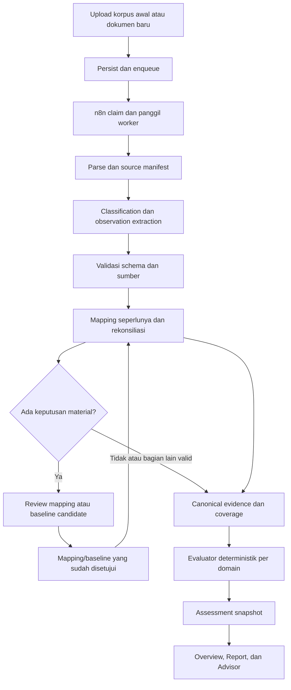

# PRD — Evidence Normalization, Reviewable Mapping, dan Baseline Proyek

**Status:** Proposed; merangkum arah yang disetujui sementara dalam percakapan. Detail requirement, target evaluasi, dan pembagian implementasi di bawah adalah usulan untuk review, bukan fitur yang sudah tersedia atau persetujuan produksi.

**Lingkup:** Inisialisasi evidence proyek, ekstraksi lintas format, pemetaan ke kontrak assurance, baseline berversi, assessment berkala, serta task allocation single-LLM/multi-LLM.

**Lingkungan implementasi:** XAss-Development. Pengiriman dokumen korporasi ke provider baru dan deployment produksi memerlukan persetujuan terpisah.

**Model/vendor:** Tidak ditentukan. Nama model yang pernah dibahas bukan dependency atau keputusan pengadaan PRD ini.

## 1. Ringkasan keputusan

Sistem menerima dokumen proyek dalam format dan istilah yang digunakan perusahaan, mempertahankan evidence aslinya, lalu memetakan evidence yang dapat dipertanggungjawabkan ke output terstruktur yang dibutuhkan Assurance Review, Overview, Report, dan AI Advisor.

Keberhasilan bukan berarti semua kolom terisi. Keberhasilan berarti sistem dapat membedakan apa yang didukung sumber, apa yang belum diketahui, apa yang bertentangan, dan keputusan apa yang diperlukan dari reviewer.

### 1.1 Keputusan terakhir dari percakapan

| ID | Keputusan | Implikasi produk |
| --- | --- | --- |
| D01 | User tidak wajib memiliki atau mengikuti template dokumen PMO tertentu. | Bulk intake tetap dapat dimulai tanpa klasifikasi manual atau konfigurasi istilah lengkap. |
| D02 | “Template bayangan” adalah kontrak output evidence/assurance, bukan format input dokumen. | Isi dokumen tidak boleh dipaksa menjadi fakta yang tidak tersedia. |
| D03 | Glosarium lengkap bukan prasyarat onboarding. | Tidak ada langkah wajib “ekstrak dan setujui semua definisi” sebelum upload atau ekstraksi berjalan. |
| D04 | Mapping dibuat saat diperlukan, bersumber, dapat ditinjau, dan dapat direvisi. | Mapping yang disetujui dapat dikumpulkan menjadi referensi istilah proyek; tampilan glosarium bersifat turunan, bukan sumber kebenaran baru. |
| D05 | Agent dapat mengusulkan relasi istilah dan pemetaan field. | Keputusan ambigu atau berdampak material tidak diterima hanya karena model merasa yakin. |
| D06 | Baseline disiapkan sejak awal sebagai kandidat evidence pack. | Tidak harus satu dokumen khusus; sumber yang berbeda dapat mendukung domain atau komponen berbeda. |
| D07 | Persetujuan baseline merupakan tindakan manusia berwenang. | Proposal, file tertua, judul “baseline”, atau voting model bukan persetujuan baseline. |
| D08 | n8n mengorkestrasi; worker memanggil LLM. | Satu tahap bisnis dapat berisi beberapa panggilan model di worker, bukan satu prompt berisi seluruh folder. |
| D09 | Kondisi Budget, Schedule, dan Risk dihitung aplikasi. | LLM mengekstrak dan mengusulkan mapping, tidak menentukan skor akhir atau mengubah ambang evaluasi. |
| D10 | Lebih dari satu LLM dimungkinkan tetapi tidak diwajibkan. | Pemisahan berdasarkan tugas dan kemampuan; pilihan provider/model ditentukan evaluasi serta kebijakan data. |

### 1.2 Hubungan dengan dokumen produk sebelumnya

PRD ini memperluas [Phase 6 Evidence Intake and Grounded Advisor PRD](phase-6-evidence-intake-and-grounded-advisor-prd.md) dan mempertahankan journey Assurance Review dari [Phase 3](phase-3-usable-mvp-spec.md).

Perubahan yang diusulkan terhadap batas Phase 6:

- Memperbolehkan reasoning lintas dokumen secara terbatas untuk mapping, rekonsiliasi, dan kandidat baseline; tetap melarang satu prompt tanpa batas yang berisi seluruh ZIP/korpus.
- Memperbolehkan beberapa model di dalam worker melalui task routing. Tidak memperkenalkan orkestrasi agent otonom atau agent yang bebas menulis database di n8n.
- Tidak mewajibkan free/local model untuk semua tugas. Deployment lokal tetap dapat didukung apabila lolos quality gate yang sama.
- Mengganti gagasan awal “glosarium wajib dahulu” dengan mapping berdasarkan kebutuhan.
- Memisahkan readiness operasional, kelengkapan evidence, dan kondisi bisnis. Assessment selesai tidak otomatis berarti evidence lengkap atau proyek sehat.

PRD ini tidak mengubah dokumen lama secara diam-diam. Pada implementasi, kontrak dan dokumentasi runtime yang terdampak harus diperbarui mengikuti cutover yang eksplisit.

## 2. Kondisi eksisting dan kesenjangan

Bagian ini berdasarkan pembacaan source code/dokumen repository, bukan bukti runtime deployment atau benchmark model.

| Area | Eksisting yang diamati | Kebutuhan baru |
| --- | --- | --- |
| Intake dan orchestration | Dokumen menjadi job; workflow polling n8n memanggil endpoint Next.js worker. | Tambahkan orchestration tahap normalisasi/assessment pada snapshot dokumen yang jelas, tanpa menggandakan consumer. |
| Parsing | Parser mempertahankan lokasi sumber; PDF/image OCR menggunakan alat lokal. `processDocumentJob` memanggil parser lalu ekstraksi LLM. | Bedakan parsing/OCR dari pemahaman semantik. LLM tidak wajib untuk membaca setiap byte/file. |
| Classification | Satu classifier tingkat dokumen menggunakan preview dan referensi terbatas. | Pertahankan label primer dokumen tetapi izinkan observasi dari beberapa section, tanggal, atau fungsi di dalam file yang sama. |
| Group extraction | Maksimum tiga chunks dan 10.000 karakter per grup; maksimum 32 grup per dokumen pada konfigurasi source saat ditinjau. | Ekstraksi bounded tetap digunakan; konteks mapping diberikan secara relevan dan coverage dilacak. |
| Structured facts | Jenis fakta utama: risk, issue, milestone, decision, owner_action. Ada summary, alerts, actions, dan health snapshots. | Evidence bertipe perlu mencakup metrik biaya, progres, procurement, scope, serta relasi entitas tanpa memaksa semuanya menjadi risk. |
| Assurance | `runAssuranceAnalysis` membaca `document_chunks` dari baseline/current yang dipilih dan memanggil LLM lagi; bukan langsung mengonsumsi facts n8n. | Buat satu jalur evidence ternormalisasi yang menjadi input assessment; tidak cukup hanya menambah node upstream tanpa memigrasi consumer Assurance. |
| Review request | Gabungan baseline/current dibatasi 24.000 karakter oleh `reviewEvidenceFits`. | Korpus besar diproses menjadi evidence terpilih yang terlacak, bukan menaikkan context window sebagai satu-satunya solusi. |
| Evaluation | Budget/Schedule/Risk dihitung deterministik. Budget saat ini memakai forecast atau fallback actual. | Tambahkan pemeriksaan kesetaraan makna metrik agar actual-to-date tidak menyamar sebagai forecast-at-completion. |
| Overview/Report | Hasil berpusat pada Assurance Review, findings, actions, dan selected evidence. Report UI memeriksa readiness review. | Mapping/normalisasi harus benar-benar masuk ke jalur findings dan report, termasuk state incomplete. |
| Model routing | Worker dan helper aplikasi memakai environment provider/model global. Adapter compatible meminta `json_object`. | Routing per logical task dan dukungan schema sesuai kemampuan endpoint; satu model tetap konfigurasi yang valid. |

“Expected chunks” bukan field template. Chunk adalah unit pemrosesan sumber; dokumen tanpa anggaran bukan berarti kehilangan sebuah chunk anggaran. Field anggaran dapat tidak diketahui meskipun seluruh chunks berhasil diproses.

## 3. Masalah yang diselesaikan

### 3.1 Dokumen rapi tidak mewakili seluruh penggunaan nyata

`demo-evidence-fixtures/realistic-pmo-cases/` menyediakan approved baseline, beberapa periode, cost report, risk register, dan expected results. Paket ini berguna untuk acceptance regression. Paket tersebut tidak membuktikan kemampuan memahami seluruh budaya dokumentasi perusahaan atau seluruh istilah dalam proyek nyata.

Pada `SMART BUILDING/`, beberapa jenis masalah berbeda muncul:

1. Nama solusi, elemen regulasi, komponen proyek, dan perangkat dapat merujuk ke hal yang berkaitan tetapi tidak identik.
2. File yang sama dapat mengandung beberapa MoM/periode, tabel pengadaan, komentar, dan keputusan yang belum final.
3. Harga proposal/pengadaan tidak otomatis sama dengan approved project budget, actual spend, atau forecast at completion.
4. Ketidaksesuaian antarangka atau istilah dapat merupakan konflik, perubahan scope, perbedaan waktu, atau perbedaan level agregasi.
5. File template/Read Me menjelaskan cara mengisi laporan, tetapi bukan evidence bahwa pekerjaan benar-benar selesai.
6. Dokumen hasil ekspor tracker dapat bukan system of record; metadata sumber harus mempertahankan batas ini.

### 3.2 Contoh evidence yang mendasari desain

- Proposal mendefinisikan Smart Area Monitoring sebagai CCTV analytics; dokumen Komponen Wajib BGC menghubungkannya dengan Sistem Kamera Pengawas. Hubungan ini tidak otomatis menyamakan produk, elemen sistem, dan perangkat CCTV.
- Smart VIANA Access Control didefinisikan melalui video analytics pada proposal; materi BGC memuat komponen kontrol akses yang lebih luas. Sistem harus mempertahankan scope, bukan sekadar cosine similarity atau kemiripan kata.
- Dokumen pemetaan menandai sistem air sebagai “diubah dari proposal”. Ini bukan alias biasa.
- Proposal menyebut biaya peralatan Rp6.337.800.000, TOTAL BARANG Rp6.093.800.000, dan keseluruhan dengan support Rp6.633.800.000. Sistem harus membedakan kategori total dan menandai ketidakcocokan biaya peralatan, bukan memilih angka pertama atau terbesar.
- Weekly Kelistrikan mendefinisikan progres berdasarkan deliverable/work package serta kesiapan Device → Data → Interface → BISMA → Testing. Pemasangan device saja tidak membuktikan kesiapan integrasi selesai.

Contoh tersebut menjadi dasar skenario uji. PRD ini tidak menetapkan mana angka SCIC yang benar atau status proyek SCIC saat ini.

## 4. Tujuan dan non-goals

### 4.1 Tujuan produk

1. User dapat mengunggah dokumen yang mereka miliki tanpa menyiapkan template atau glosarium.
2. Sistem mengekstrak evidence relevan dan mempertahankan istilah, sumber, serta ketidakpastiannya.
3. Sistem menyarankan pemetaan ke output assurance dengan alasan yang dapat diperiksa.
4. Reviewer dapat membentuk baseline dari sumber nyata, menyetujui perubahannya, dan melihat riwayat penggunaannya.
5. Overview dan Report tetap berguna ketika evidence parsial, tanpa menampilkan status sehat yang tidak didukung.
6. Hasil dapat ditelusuri dari kalimat report sampai observasi, lokasi sumber, keputusan mapping, dan baseline version.
7. Kualitas model dinilai pada kasus domain nyata, bukan hanya format JSON atau ukuran parameter.
8. Deployment satu maupun beberapa model mempunyai kontrak bisnis dan quality gate yang sama.

### 4.2 Non-goals

- Glosarium global seluruh perusahaan atau knowledge graph universal.
- Training/fine-tuning model khusus sebagai syarat implementasi.
- Vector database baru sebelum retrieval eksisting dievaluasi.
- Penggantian semua parser dengan vision LLM.
- Agent yang bebas menjalankan SQL, mengubah approval, memilih vendor sendiri, atau membuat tool baru.
- Persetujuan hukum/kontrak, sertifikasi kepatuhan BGC, atau keputusan go/no-go otomatis.
- Menentukan status supplier atau realisasi pembayaran hanya dari tautan marketplace.
- Menambah seluruh dimensi dashboard baru untuk setiap komponen SCIC. Evidence non-assurance disimpan sebagai konteks/detail; tiga domain utama tetap Budget, Schedule, Risk.
- Menghasilkan dokumen baseline palsu untuk memenuhi syarat UI.
- Mengubah informasi percakapan Advisor menjadi sumber fakta proyek tanpa pencatatan keputusan/evidence yang eksplisit.

## 5. Pengguna dan kewenangan

| Aktor | Tugas | Tidak diperbolehkan |
| --- | --- | --- |
| Uploader / anggota proyek | Upload, melihat progres, memberi hint bila tahu, menambahkan evidence. | Menganggap hint sebagai approval atau mengakses proyek lain. |
| PMO/reviewer dengan hak pengelolaan proyek | Meninjau mapping, memilih evidence, menyetujui baseline untuk review, mengoreksi periode, meninjau report. | Mengubah sumber asli atau riwayat report secara diam-diam. |
| Sponsor/viewer | Membaca kondisi, gap, findings, dan report yang diizinkan. | Mengubah baseline/mapping melalui tampilan baca. |
| Administrator | Mengelola model bindings, kebijakan data, dan kapasitas. | Menganggap izin administrasi infrastruktur sebagai approval baseline korporasi. |
| LLM/agent | Menghasilkan usulan terstruktur dengan source references. | Approve baseline, mengubah hak akses, menerbitkan report final, atau menulis accepted data langsung. |
| Worker/aplikasi | Memvalidasi, menerapkan aturan, menyimpan transisi atomik, menghitung assessment. | Menyimpulkan fakta baru hanya karena struktur output valid. |

Gunakan izin project-management dan RLS yang sudah ada. Implementasi tidak boleh memperluas hak uploader/viewer tanpa keputusan permission yang eksplisit.

## 6. Model domain

| Istilah | Definisi dalam PRD |
| --- | --- |
| Source document | File asli dengan identitas/revisi dan provenance upload. Tidak ditimpa oleh hasil AI. |
| Source reference | Referensi stabil ke bagian file: halaman, sheet/row/range, slide, paragraf/section, atau gambar. |
| Chunk / source group | Unit komputasi bounded; bukan kategori bisnis atau expected field. |
| Observation | Klaim yang diekstrak dari sumber, dengan nilai/teks asli dan konteks. Belum otomatis menjadi fakta yang diterima untuk assessment. |
| Canonical output contract | Definisi field, tipe, makna, satuan, dan persyaratan evidence yang dikonsumsi sistem; “template bayangan”. |
| Mapping proposal | Usulan hubungan istilah/entitas atau penempatan observation ke field kontrak. |
| Accepted mapping rule | Mapping yang disetujui manusia atau aturan eksplisit dari sumber yang sebelumnya diotorisasi manusia, dengan scope dan version. |
| Baseline candidate | Usulan referensi dan nilai pembanding, belum disetujui untuk dipakai sebagai baseline. |
| Baseline evidence pack | Referensi sumber dan nilai pembanding yang disetujui reviewer, termasuk scope dan tanggal efektif. Bukan harus satu DOCX. |
| Evidence snapshot | Daftar revisi dokumen dan hasil pemrosesan yang dibekukan untuk satu run/review. |
| Project context snapshot | Referensi immutable ke mapping version, baseline version, contract version, dan evaluation rules yang dipakai run. Tidak wajib berisi glosarium lengkap. |
| Assessment snapshot | Findings, actions, coverage, dan provenance hasil evaluasi untuk scope/periode tertentu. |
| Evidence gap | Input yang diperlukan tetapi belum tersedia, belum bisa dibaca, belum dipetakan, atau belum disetujui. |
| Conflict | Klaim yang tidak dapat dipakai bersamaan untuk scope/periode/makna yang sama tanpa keputusan tambahan. |
| Inference | Interpretasi/rekomendasi yang melampaui kutipan eksplisit; harus dibedakan dari reported fact dan tidak otomatis mengisi metrik. |

Pisahkan tiga hal: file menyebut “approved”, reviewer menyetujui penggunaannya sebagai baseline review, dan organisasi benar-benar memberi persetujuan kontraktual. Yang pertama adalah observation; yang kedua adalah keputusan aplikasi berprovenance; yang ketiga hanya boleh diklaim bila ada evidence yang mendukung.

## 7. Pipeline target dan batas komponen

### 7.1 Topologi

Tidak ada blocker “seluruh glosarium selesai”. Keputusan material menahan field/domain yang bergantung padanya, bukan seluruh ingest atau semua field yang tidak berkaitan.

### 7.2 Input/output setiap tahap

Nama tahap berikut adalah logical contract, bukan nama endpoint/n8n node yang sudah ada.

| Tahap | Pemilik eksekusi | Input | Output | LLM |
| --- | --- | --- | --- | --- |
| S01 Intake | Aplikasi/Storage | File, project, optional hint, submission ID. | Dokumen/revisi, manifest arsip, job terotorisasi. | Tidak. |
| S02 Dispatch | n8n + backend job claim | Job queued dan kapasitas. | Claim/lease dan request worker terautentikasi. | Tidak. |
| S03 Parse | Worker parser | File/revisi dan konfigurasi parser/OCR. | Source references, chunks, warning, coverage manifest. | Tidak secara default; vision hanya sesuai routing yang diotorisasi. |
| S04 Classify | Worker task R1 | Metadata dan preview bounded. | Jenis primer dokumen, kandidat section/period/role, sources. | Ya bila heuristik eksplisit tidak cukup. |
| S05 Extract | Worker task R2 | Grup sumber beserta heading/header, konteks relevan, contract. | Observations, excerpt references, limitations. | Ya. |
| S06 Validate | Worker rules | Output model dan source allowlist. | Validated candidates atau error per item/grup. | Tidak untuk validasi mekanis. |
| S07 Map/reconcile | Worker task R3 + rules | Candidates, approved mapping, baseline references, scoped related sources. | Mapping proposals, canonical candidates, conflicts, baseline candidates, gaps. | Hanya bagian reasoning. |
| S08 Review | Aplikasi + reviewer | Usulan dan source evidence berdampingan. | Approval/rejection/correction dengan version dan alasan. | Tidak untuk keputusan final. |
| S09 Assess | Worker/aplikasi rules | Accepted canonical evidence, baseline version, periode, coverage. | Tiga findings, condition, variance, required evidence, actions. | Tidak untuk hitungan dan condition. |
| S10 Present | Aplikasi; opsional task R5 | Assessment snapshot dan source references. | Overview, draft report, jawaban Advisor yang grounded. | Opsional untuk narasi; tidak mengubah fakta. |

n8n dapat menampilkan tahap bisnis tambahan sebagai node pemanggilan worker. Tidak perlu menambah provider node khusus. Worker menjadi pemilik penulisan hasil normalisasi/assessment melalui API/RPC yang terotorisasi; n8n tidak menulis ulang payload yang sama melalui jalur kedua. Persistensi ingestion eksisting dimigrasikan hanya sejauh diperlukan, dengan satu pemilik setiap state transition.

## 8. Functional requirements

### FR-01 — Intake tanpa template

- Bulk, ZIP, dan guided single-file intake yang sudah didukung tetap tersedia.
- Project dan file wajib; document type, workstream, dan reporting period boleh unknown.
- Upload tidak menunggu setup baseline atau glossary.
- Arsip diurai menjadi file individual; duplikasi di folder/ZIP ditandai berdasarkan content identity, bukan dihitung sebagai evidence independen.
- Hasil setiap dokumen tetap terlihat saat file lain gagal.

### FR-02 — Parsing, struktur, dan coverage

- Pertahankan original file dan lokasi source; jangan hanya menyimpan ringkasan LLM.
- Sertakan header tabel/section yang diperlukan ketika membentuk grup. Jangan kehilangan makna harga awal versus harga revisi atau baseline versus forecast karena header terpisah.
- Parsing formula Excel mengikuti kemampuan parser: cached value dan formula harus dapat dibedakan. Nilai cache yang tidak tersedia bukan nol; sistem tidak mengklaim telah menghitung ulang workbook.
- Read Me, petunjuk pengisian, contoh, baris kosong, dan placeholder template tidak boleh menjadi laporan progres aktual.
- Jika OCR/parser tidak lengkap, tampilkan `not_processed`/limitation; jangan menyebut field `not_found_in_scope` untuk bagian yang belum terbaca.
- Setiap snapshot mencatat dokumen/grup expected, completed, failed, excluded, dan alasan exclusion. `not_found_in_scope` hanya berlaku dalam ruang pencarian yang disebutkan, bukan klaim seluruh perusahaan tidak memiliki data tersebut.

### FR-03 — Klasifikasi dokumen dan periode

- Document type, evidence role, tanggal dokumen, reporting period, dan workstream adalah field berbeda.
- Filename dan hint adalah petunjuk, bukan bukti approval atau fakta bisnis.
- Satu file MoM gabungan dapat menghasilkan observations dari beberapa tanggal. Satu label primer tidak menghapus section-level context.
- Upload date tidak menjadi document date. “Awal Desember” dipertahankan sebagai tanggal tidak presisi; jangan diam-diam menjadi 1 Desember.
- Kandidat baseline/current/supporting dapat berbeda menurut review dan bagian sumber. Satu artefak tidak wajib mempunyai satu role global untuk seluruh masa proyek.

### FR-04 — Evidence extraction yang tidak memaksa template

- Ekstrak nilai/kalimat asli sebelum memutuskan field tujuan.
- Kategori minimum: cost/budget, milestone/schedule, risk, issue, action, decision, scope/deliverable, progress, procurement, dan relevant_unmapped.
- Simpan unit/currency, scope komponen/proyek, tanggal/periode, basis nilai, owner/due date bila disebutkan, dan source references.
- Klaim yang relevan tetapi tidak cocok dengan field assurance tetap disimpan sebagai `unmapped`; tidak otomatis menjadi risk atau alert.
- LLM tidak boleh mengarang owner, severity, mitigasi, approval, atau kelengkapan register dari diamnya sumber.
- Ekstraksi tidak menganggap setiap dokumen harus memuat semua kategori.

### FR-05 — Mapping berdasarkan kebutuhan

Mapping dilakukan ketika observation perlu dihubungkan dengan canonical field/entity atau dibandingkan dengan evidence lain.

- Gunakan ID eksplisit dan mapping yang sudah disetujui lebih dahulu, lalu reasoning model jika masih perlu.
- Sediakan kandidat relasi `synonym`, `implements`, `part_of`, `overlaps`, `distinct`, `conflicts`, dan `unknown`. Relasi berarah seperti `implements` harus mempertahankan arah.
- Relasi konsep berbeda dari field assignment. `ELISA implements Sistem Kelistrikan` tidak berarti semua angka yang menyebut ELISA adalah budget keseluruhan kelistrikan.
- Proposal mapping memuat alternatif, alasan singkat berbasis sumber, bukti pendukung/penentang, dan dampak jika diterima. Tidak perlu chain-of-thought model.
- Jangan memaksa tepat satu target. Zero-match dan ambiguous multi-match adalah hasil yang sah.
- Mapping baru yang menyatukan entitas, mengubah baseline, atau mengubah comparability metrik material membutuhkan review.
- Sistem dapat menerapkan ulang accepted rule secara otomatis hanya bila scope, jenis evidence, tanggal berlaku, dan precondition terpenuhi serta tidak ada evidence baru yang bertentangan.
- Pernyataan mapping eksplisit dalam dokumen yang belum diotorisasi masih candidate. Otoritas sumber itu sendiri tidak diberikan oleh LLM.

### FR-06 — Review dan revisi mapping

- Reviewer melihat source term, target, jenis relasi, scope, periode berlaku, dan source excerpt sebelum menerima.
- Aksi: accept, correct, reject, split entities, atau defer dengan pertanyaan yang diperlukan.
- Approval dicatat sebagai user decision. Penerapan otomatis dicatat sebagai `applied_rule` dengan rule ID, bukan approval model.
- Mapping baru tidak menghapus yang lama. Revision menyimpan effective scope/time dan hubungan supersedes.
- Mapping rejected tidak diusulkan berulang pada input identik; evidence baru dapat membuka proposal baru dengan alasan perubahan.
- Jika ada halaman “Istilah proyek”, isinya adalah accepted mappings beserta source/provenance. Tidak perlu meninjaunya agar semua pekerjaan lain dapat berjalan.

### FR-07 — Persiapan baseline sejak awal

- Sistem menginventarisasi kandidat nilai pembanding dari korpus awal setelah observations tersedia.
- Draft kandidat dapat dibuat saat mapping belum final, tetapi approval baseline menunggu keputusan mapping material yang menjadi dependency-nya.
- Baseline dapat menggabungkan approved budget dari satu sumber, milestone dari sumber lain, dan scope dari sumber lain. Sumber dan tanggal berlaku dipertahankan per field.
- Tampilkan evidence yang menyatakan approval, siapa/otoritas yang disebut, conflict, serta gap. Tidak ada default “dokumen paling awal = baseline”.
- Reviewer mengonfirmasi field/value/scope, sumber/revisi, effective date, serta approval evidence atau status approval yang belum diketahui.
- Persetujuan penggunaan baseline dalam aplikasi tidak boleh dipresentasikan sebagai corporate/contractual approval bila sumber tidak membuktikannya. Field yang membutuhkan approved baseline tetap belum eligible sampai status otoritasnya terpenuhi.
- Candidate pack dapat disimpan meskipun sebagian domain kosong. Domain dengan baseline yang valid dapat dinilai; domain lain tetap incomplete.
- Sistem boleh menyusun halaman ringkasan baseline evidence pack, tetapi dokumen ringkasan tersebut tidak menjadi sumber primer untuk membuktikan fakta yang dibuatnya sendiri.

### FR-08 — Dokumen baru, revision, dan rebaseline

- Dokumen baru menambah observations dan dapat mengusulkan mapping/baseline change; tidak mengganti baseline aktif otomatis.
- Current forecast yang bergeser bukan rebaseline. Perubahan target tanpa approval tetap variance terhadap baseline sebelumnya.
- Revision baseline membutuhkan reviewer, alasan perubahan, evidence perubahan, tanggal efektif, dan review terdampak.
- Snapshot lama tetap menunjuk baseline/mapping lama. Hasil historis tidak ditulis ulang ketika konteks aktif berubah.
- Reassessment atas periode lama membuat versi hasil baru dengan relationship ke hasil lama dan alasan, bukan memperbaiki history tanpa jejak.

### FR-09 — Rekonsiliasi lintas dokumen

- Rekonsiliasi membandingkan entity, metric meaning, unit, scope, periode/as-of, dan source authority sebelum value.
- Nilai berbeda antarperiode dapat menjadi perkembangan, bukan konflik. Nilai item versus total tidak boleh diadu seolah identik.
- Source precedence berlaku sesuai domain/field dan keputusan proyek, bukan aturan global “file terbaru menang”. Regulasi adalah definisi/kewajiban, bukan bukti bahwa proyek sudah memenuhi kewajiban.
- Konflik tidak diselesaikan dengan mayoritas dokumen, mayoritas model, confidence tertinggi, atau ringkasan paling meyakinkan.
- Original claims tetap tersimpan ketika reviewer memilih salah satunya. Keputusan menyebut alasan dan scope.
- Deduplikasi occurrence menjaga semua asal dokumen tetapi tidak menggandakan risk/action/procurement item yang sama.

### FR-10 — Canonical evidence dan eligibility

- Hanya observation tervalidasi dengan mapping/context yang dapat dipertanggungjawabkan masuk ke input evaluator.
- Masing-masing input mempunyai source provenance, observation ID, mapping rule/decision ID bila relevan, dan baseline/context snapshot ID.
- Unknown, ambiguous, conflict, not processed, dan not applicable tidak direduksi menjadi zero.
- Coverage dihitung dari manifest dan required evidence checklist yang jelas; jumlah citation bukan ukuran persentase kelengkapan informasi bisnis.
- Bila satu grup gagal, field yang bergantung padanya tertahan. Field lain hanya dapat dipakai bila sumber dan kelengkapan lokalnya jelas; sistem tidak membuat kesimpulan negatif global dari evidence parsial.

### FR-11 — Assessment deterministik

- Evaluator menggunakan kontrak pada bagian 9, bukan narasi atau health score LLM.
- Ambang Budget/Schedule/Risk eksisting dipertahankan untuk metrik yang comparable; perubahan semantik comparability diberi rule version baru.
- Satu hasil selalu menyatakan review period, baseline/context/evidence snapshot, condition per domain, evidence gaps, dan conflicts.
- Kesimpulan yang tidak dapat dihitung menghasilkan `more_evidence_required` dengan alasan spesifik.
- Critical finding yang didukung evidence tetap terlihat walau domain lain incomplete; satu badge overall tidak boleh menutupi critical matter.
- Action yang dihasilkan sistem dibedakan dari action yang memang diperintahkan dalam MoM. Owner rekomendasi tidak boleh disajikan sebagai penugasan yang sudah disetujui.

### FR-12 — Overview dan Report

- Overview menampilkan tiga domain dengan status dan coverage, termasuk “Belum ada baseline disetujui” atau “Forecast belum tersedia”; bukan halaman kosong karena semua field belum lengkap.
- Navigasi Overview/Report tidak bergantung pada tersedianya semua angka. Kondisi bisnis dan readiness membuat draft adalah dua state berbeda.
- Draft report dapat dibuat setelah assessment snapshot tersimpan dan tidak ada job dependency yang masih aktif. Draft boleh berstatus incomplete dengan gap/conflict eksplisit.
- Required parsing yang gagal tidak dianggap complete assessment; user harus memperbaiki atau secara eksplisit mengecualikan sumber tersebut. Exclusion tetap muncul sebagai keterbatasan, bukan bukti bahwa tidak ada risiko.
- Export final memerlukan review manusia dan pengakuan keterbatasan jika report incomplete. Report tidak boleh menyebut dirinya complete tanpa memenuhi required evidence.
- Report dan Overview mengonsumsi snapshot yang sama. Report composer tidak membaca ulang korpus untuk mengganti angka/condition secara independen.
- Koreksi editorial report tidak mengubah facts/baseline. Koreksi fakta diarahkan ke evidence review lalu assessment baru.

### FR-13 — Advisor tetap grounded

- Advisor memakai snapshot yang dipilih dan authorized source evidence yang relevan.
- Jawaban membedakan fakta, keputusan reviewer, inference, dan pertanyaan yang belum terjawab.
- Advisor tidak menyetujui mapping/baseline melalui chat dan tidak menganggap percakapan sebelumnya sebagai primary evidence.
- Jika ditemukan istilah belum dipetakan, Advisor dapat menunjuk/membuat candidate review item melalui jalur aplikasi terkontrol, bukan mengubah accepted mapping langsung.

### FR-14 — Eksekusi background dan single writer

- Intake, extraction, normalization, review decision, dan assessment mempunyai status persisted; halaman browser tidak perlu tetap terbuka setelah upload/import selesai.
- Batch awal menjadi manifest/snapshot saat submission selesai. Tidak menunggu seluruh dokumen yang mungkin datang di masa depan.
- Dokumen yang tiba ketika run berjalan masuk ke snapshot berikutnya atau memicu run lanjutan; run aktif tidak berubah diam-diam.
- Worker resume dari checkpoint yang compatible dan mempertahankan idempotency. Hanya satu pihak menguasai finalisasi setiap output.
- Model tidak mengendalikan loop retry. Dispatch/retry/lease tetap di orchestrator/backend.

### FR-15 — Model-agnostic execution

- Semua logical roles pada bagian 10 dapat diarahkan ke satu model yang lolos evaluasi atau ke beberapa model.
- Endpoint support, schema support, context limit, timeout, modality, dan data policy diuji per binding.
- Tidak ada daftar model rekomendasi yang menjadi hardcoded business requirement.
- Perubahan model/prompt/schema harus tercatat dan tidak menyebabkan reuse cache dengan konteks berbeda.

## 9. Kontrak output: template bayangan

### 9.1 Dua lapisan, bukan dua sumber kebenaran

1. **Evidence layer:** observations dan mappings, termasuk procurement/scope/progress yang belum menjadi tiga finding utama.
2. **Assessment projection:** input Budget/Schedule/Risk yang diturunkan dari accepted evidence dengan provenance lengkap.

Lapisan kedua adalah projection yang bisa dibangun ulang dari snapshot pertama; bukan ekstraksi LLM independen yang mengklaim kebenaran berbeda.

### 9.2 Required meaning per domain

| Domain | Evidence minimum untuk perbandingan | Tidak boleh disubstitusi |
| --- | --- | --- |
| Budget | Approved baseline amount, scope biaya, currency; current forecast-at-completion dengan scope/currency sebanding. Completed final actual boleh dipakai bila finalitasnya eksplisit. | Purchase request, unit price, quote, committed cost, atau actual-to-date menjadi forecast-at-completion. |
| Schedule | Milestone/entity yang sama; baseline date yang disetujui dan current forecast date; tanggal cukup presisi untuk hitungan. | Due date satu action menjadi tanggal selesai proyek; forecast menjadi baseline baru; progress percent menjadi delay days. |
| Risk | Current risk evidence dengan scope/period jelas; severity/owner/mitigation yang disebutkan atau diputuskan reviewer; prior evidence comparable untuk klaim new/increased. | Tidak disebut = zero; seluruh blocker = high risk; ketidakhadiran owner pada kutipan sempit = bukti owner tidak ada di seluruh register. |

Ketentuan tambahan:

- Currency berbeda atau cost scope yang tidak jelas menahan variance; tidak ada konversi kurs atau penggabungan biaya yang tidak diminta.
- Actual-to-date di bawah budget tidak cukup untuk menyatakan final forecast on track. Actual-to-date di atas approved budget dapat menghasilkan finding deterministik “biaya yang sudah terjadi melampaui budget”, dengan label basis actual, bukan forecast.
- Untuk budget forecast yang comparable, threshold saat ini tetap: tidak melebihi baseline = on track; lebih dari 0% hingga 5% = needs attention; lebih dari 5% = critical.
- Schedule comparable mempertahankan threshold saat ini: tidak terlambat = on track; 1–14 hari = needs attention; lebih dari 14 hari = critical.
- Risk critical yang teridentifikasi dapat dieskalasi tanpa mengklaim seluruh risk population sudah diketahui. On track memerlukan coverage risk yang memadai, bukan hanya tidak ditemukan critical pada subset.
- `open_critical_count: 0` hanya diterima jika nol eksplisit atau dihitung dari cakupan register yang diketahui lengkap untuk scope tersebut. Unknown risk count perlu direpresentasikan nullable/berstatus; schema risk numerik eksisting harus dimigrasikan agar tidak memaksa nol.
- Threshold RAG dalam weekly template merupakan evidence definisi lokal; tidak otomatis mengganti assurance thresholds tanpa keputusan evaluation rule.

### 9.3 State evidence dan keputusan dipisahkan

| Dimensi | State | Makna |
| --- | --- | --- |
| Ketersediaan | `found` | Klaim/value ditemukan pada sumber yang disebut. |
| Ketersediaan | `not_found_in_scope` | Tidak ditemukan pada scope yang benar-benar diproses. |
| Ketersediaan | `not_processed` | Pembacaan/retrieval belum lengkap atau gagal. |
| Interpretasi | `ambiguous` | Ada lebih dari satu interpretasi/mapping yang masuk akal. |
| Interpretasi | `conflicting` | Ada klaim incompatible dalam scope comparable. |
| Applicability | `not_applicable` | Ketidakberlakuan didukung keputusan/aturan, bukan ketiadaan data. |
| Keputusan | `candidate`, `needs_review`, `accepted`, `rejected`, `superseded` | Lifecycle acceptance, terpisah dari apakah value ditemukan. |

Null numerik tanpa status/alasan tidak cukup. Field wajib hadir pada envelope/schema tidak berarti nilainya wajib non-null.

## 10. Task allocation single-LLM dan multi-LLM

### 10.1 Prinsip pemisahan

“Agent” dalam PRD adalah task worker dengan input/output dan tools yang dibatasi. Agent bukan proses otonom yang bebas menentukan pipeline. Setiap task bersifat stateless; konteks bersama berasal dari database/snapshot, bukan memori percakapan antar-model.

Jumlah logical roles tidak sama dengan jumlah model, proses, atau API call. Classification dan extraction tetap boleh menjadi tugas terpisah yang memakai model sama. Mapping yang sudah resolved oleh rule tidak memerlukan panggilan reasoning baru.

### 10.2 Role matrix

| Role | Tugas | Input yang diberikan | Output yang diwajibkan | Larangan |
| --- | --- | --- | --- | --- |
| R1 — Document classifier | Mengenali fungsi dokumen/section dan kandidat metadata. | Preview, filename, parser metadata, source refs, hint berlabel hint. | Artifact type, kandidat role/date/period, alasan dan source refs, limitations. | Menetapkan approval, mengekstrak semua nilai dari preview, atau menilai kesehatan proyek. |
| R2 — Evidence extractor | Mengambil observations dari semua grup yang relevan dalam dokumen. | Source group + heading/header, source allowlist, definisi field, subset accepted context bila relevan. | Observations bertipe, raw values, unit, scope, periode, kutipan, uncertainty. | Memilih nilai menang lintas dokumen tanpa evidence, menghitung condition, mengisi missing value. |
| R3 — Semantic mapper/reconciler | Memadankan istilah/entity/metric, membandingkan scope, menyusun kandidat baseline dan konflik. | Validated observations + original excerpts, kandidat target, approved rules, baseline context, related source refs. | Field assignment/term relation proposals, match/no-match/ambiguous, conflict set, baseline candidates, reasoning summary berbukti. | Menyetujui baseline, menganggap source terbaru selalu authoritative, atau menimpa observation. |
| R4 — Semantic verifier, opsional | Menguji apakah sebuah usulan didukung atau dibantah sumber. | Proposal, field definition, original sources, evidence yang berpotensi berlawanan; bukan hanya ringkasan R3. | `supported`, `unsupported`, atau `uncertain` beserta field yang dipermasalahkan dan sumber. | Menjadi otoritas kebenaran terakhir, menyetujui perubahan baseline, atau menyelesaikan konflik melalui voting. |
| R5 — Report/Advisor narrator | Menjelaskan findings dan menjawab pertanyaan dengan evidence terotorisasi. | Immutable assessment snapshot, approved actions, allowed sources, batasan/incomplete flags, pertanyaan bila ada. | Narasi atau claims bercitation; inference/rekomendasi terpisah. | Mengganti angka, thresholds, baseline, owner, status, atau membuat bukti baru. |
| RV — Vision extraction, kondisional | Membantu membaca halaman/gambar/tabel yang parser/OCR tidak memadai. | Halaman/gambar yang diizinkan dengan identitas source; bukan seluruh folder secara default. | Transkripsi/observations dengan page/image locator, warning keterbacaan, provenance model. | Menciptakan nomor sel/page atau kutipan teks yang tidak dapat ditelusuri ke gambar. |

Task R3 mencakup mapping dan reasoning rekonsiliasi karena input domainnya berdekatan. Tidak perlu membuat beberapa agent persona yang berdebat untuk satu keputusan.

### 10.3 Tugas yang tidak dialokasikan ke LLM

- File signature validation, ZIP safety, Storage authorization, content hashing, dan parsing native.
- Source allowlist, schema/type validation, pemeriksaan lokasi/currency/date, dan cek excerpt terhadap sumber.
- Permission, source authority policy, approval baseline, dan mutation state.
- Idempotency, retry budgets, cache compatibility, concurrency, dan pemilihan model berdasarkan routing configuration.
- Arithmetic variance/delay, risk count dari register yang validated dan complete, penentuan condition, dan readiness report.
- Penguncian snapshot, histori version, penerbitan final report, dan keputusan akses data vendor.

Pemeriksaan excerpt yang benar hanya membuktikan lokasi kutipan. Itu tidak cukup membuktikan bahwa kutipan mengandung nilai yang tepat atau mendukung relasi yang diajukan; semantic validation/review tetap diperlukan.

Untuk RV, sumber primer tetap gambar/halaman asli, bukan transkripsi yang dibuat model. Simpan metode pemeriksaan sumber, misalnya `exact_text_match` atau `visual_review`; jangan mengklaim exact-text verification ketika hanya tersedia gambar. Nilai material yang hanya terbaca melalui vision dan tidak dapat diverifikasi terhadap representasi sumber independen memerlukan review visual manusia sebelum dipakai untuk assessment. RV tetap opsional; ketidaktersediaannya menghasilkan limitation/review, bukan alasan memalsukan parsing berhasil.

### 10.4 Pilihan deployment

| Mode | Binding tugas | Kapan layak | Trade-off |
| --- | --- | --- | --- |
| Satu model | R1–R3 dan R5 memakai model yang sama dengan prompt/contract berbeda; R4 tidak wajib. | Operasional sederhana, volume kecil, model lolos semua role gate. | Tidak ada independensi model; biaya reasoning bisa dibayar pada tugas sederhana. |
| Dua model | Model A untuk R1/R2 dan R5 jika lolos; Model B untuk R3 dan eskalasi kasus R2. R4 selective pada B hanya self-check, bukan independent verification. | Ekstraksi volume tinggi dengan mapping lebih jarang/kompleks. | Salah ekstraksi di A dapat menghilangkan evidence sebelum B melihatnya; R3 perlu akses original excerpts dan targeted re-read. |
| Tiga model | A untuk extraction; B untuk mapping; C untuk R4 pada kasus berisiko/material. R5 memakai salah satu yang lolos. | Evaluasi menunjukkan verifier menurunkan error material dengan biaya yang dapat diterima. | Agreement antar-model tetap bukan bukti benar; latency dan review conflicts dapat meningkat. |
| Restricted-data | Role diarahkan hanya ke deployment lokal/private yang diizinkan. | Dokumen tidak boleh dikirim ke cloud tertentu. | Jika capability/quality tidak memadai, minta review; tidak ada fallback keluar perimeter data. |

Model A/B/C adalah label deployment, bukan asumsi kualitas dari nama atau ukuran parameter. Binding bisa berubah setelah evaluation. Model yang tidak lulus R3 masih bisa lulus R1; tidak harus dieliminasi dari semua tugas.

### 10.5 Trigger task dan urutan pada multi-LLM

1. Worker membaca task binding dan capability policy yang dipin untuk run.
2. R1 mengusulkan klasifikasi; hasilnya tidak meniadakan sumber yang belum dibaca R2.
3. R2 memproses source groups dengan bounded concurrency; validated observations di-checkpoint.
4. Deterministic mapper mencoba direct field semantics, explicit IDs, dan accepted scoped rules.
5. Hanya unresolved/material cases masuk R3. R3 menerima raw excerpts agar tidak terikat kesalahan ringkasan R2.
6. Jika retrieval kurang, worker dapat mengambil related sources secara project-scoped dan bounded. Tidak ada model-controlled open-ended crawling.
7. R4 hanya dipanggil oleh policy pada kasus tertentu, misalnya usulan merge entity berpengaruh pada budget atau konflik definisi. R4 bukan tahap wajib untuk setiap row.
8. Validasi dan acceptance policy menentukan accepted evidence atau human review. Baseline activation tetap membutuhkan reviewer meskipun semua model setuju.
9. Evaluator menghasilkan assessment; R5 menerima hasil yang sudah diputuskan untuk narasi.

Contoh SCIC: R2 mengekstrak nilai proposal dan purchase request secara terpisah; R3 mengusulkan `proposed_cost` serta `procurement_request_amount`, bukan `approved_budget`/`actual_cost`; reviewer memilih evidence approval jika tersedia. Tanpa approval/current comparable, evaluator menampilkan gap Budget. Model yang lebih kuat tidak diberi tugas mencari angka pengganti agar dashboard hijau.

### 10.6 Kontrak handoff antar-task

Setiap request membawa:

- `task_run_id`, `task_role`, `project_id`, serta document/review IDs sesuai scope.
- Evidence snapshot dan daftar source references yang boleh digunakan.
- Input schema version, output contract version, prompt version, routing policy version.
- Relevant mapping/baseline versions; role extraction tidak perlu menerima seluruh profil.
- Task instructions, evidence untrusted yang dibatasi jelas, dan permitted output decisions.
- Input/output limit dan budget dari worker, bukan instruksi model untuk mengatur anggarannya sendiri.

Setiap response yang disimpan membawa:

- Structured result dan source references per material claim.
- Missing/ambiguous/conflicting fields dan limits yang terdeteksi.
- Actual provider, model identifier/version yang tersedia, task role, attempt, serta parameter generasi relevan.
- Schema/citation/semantic validation results yang ditambahkan worker; bukan self-reported pass dari LLM.
- Token/latency/cost bila provider menyediakannya; jika tidak tersedia tandai unavailable, jangan menciptakan angka.

Konteks dari task sebelumnya adalah candidate data, bukan instruksi baru atau fakta otomatis. Semua source IDs yang dikutip harus berada pada authorized scope dan dapat dibuka kembali.

### 10.7 Capability dan structured output

- Provider binding menyatakan kemampuan JSON Schema/JSON mode, modalities, supported parameters, input/output limits, retention/residency, serta approval data class.
- Gunakan schema-constrained output jika didukung endpoint tersebut, tetap validasi di aplikasi dan tangani refusal/truncation.
- JSON mode hanya menjanjikan format JSON pada provider yang mendukungnya; bukan kepatuhan business schema atau semantic correctness.
- Endpoint “OpenAI-compatible” tidak menjamin parameter identik, dukungan schema, atau dukungan temperature/reasoning yang sama. Adapter harus capability-aware.
- Jangan mengganti global env model sebagai satu-satunya implementasi routing; worker, Assurance, dan Advisor harus menggunakan logical bindings yang eksplisit dan tercatat.

### 10.8 Routing, escalation, dan biaya

Default usulan: gunakan satu atau dua model dahulu. Model tambahan/verifier diaktifkan hanya setelah benefit terukur.

| Kondisi | Tindakan |
| --- | --- |
| Mapping rule yang accepted cocok dan tidak ada contradiction | Terapkan rule; tidak panggil reasoning model. |
| Relasi/metric semantics ambigu tetapi sumber tersedia | Panggil R3 pada binding yang lolos semantic-mapping evaluation. |
| Schema output invalid | Maksimum satu corrective re-call pada binding yang sama, jika aman dan budget tersisa. |
| Hasil tetap invalid atau capability tidak cocok | Fail task atau sekali eskalasi ke binding yang sudah diotorisasi; tidak memilih provider bebas. |
| Field material tetap ambiguous | Human review dengan evidence; jangan terus memanggil model sampai salah satunya memberi jawaban pasti. |
| Model berbeda menghasilkan keputusan material berbeda | Simpan disagreement; human review. Confidence terbesar tidak memenangkan keputusan. |
| Source tidak ada/belum diproses | Targeted read/reprocess atau gap. Model lebih kuat tidak dapat menggantikan sumber yang tidak ada. |
| Timeout/rate limit | Retry transport bounded oleh job policy; bedakan dari semantic retry dan hindari n8n+worker retry ganda. |
| Budget task/run habis | Checkpoint dan state actionable; tidak menurunkan kualitas/menyembunyikan sumber secara diam-diam. |
| Model eskalasi tidak diizinkan memproses dokumen | Jangan kirim; review manual atau deployment yang memenuhi policy. |

Batas total panggilan mencakup initial, corrective, transport retries, dan escalation. Setiap task harus mempunyai finite attempt/deadline; tidak ada recursive agent loop. Numeric cost ceiling dan SLA ditetapkan setelah benchmark pada deployment yang dipilih, sebelum production gate, bukan angka performa rekaan dalam PRD.

Self-reported confidence boleh menjadi sinyal antrean review, tetapi tidak menjadi satu-satunya pemicu auto-accept atau ukuran probabilitas kebenaran.

## 11. Data contract dan lifecycle

Entitas berikut adalah kontrak logis, bukan kewajiban membuat satu tabel baru untuk setiap baris. Reuse struktur repository bila invariant dapat dipertahankan.

| Entitas | Data penting | Invariant |
| --- | --- | --- |
| Document revision/source | Project, content hash, Storage identity, parser version, source locator. | Sumber historis tidak ditimpa oleh upload pengganti. |
| Observation | Source IDs, raw text/value, metric/entity candidates, unit, scope, time, extraction provenance. | Klaim tidak kehilangan bahasa/nilai sumber saat dinormalisasi. |
| Mapping proposal/decision | Source term/observation, target, relation, scope, evidence, state, actor/reason. | Candidate tidak diperlakukan sebagai accepted rule. |
| Baseline version | Field selections, source revisions, approval metadata, scope, effective date, supersedes. | Tidak aktif hanya karena model mengeluarkan label approved. |
| Context/evidence snapshot | Manifest dan relevant mapping/baseline/contract/rule versions. | Run mengacu ke versi tetap. |
| Assessment result | Review period, per-domain findings, gaps/conflicts, inputs, rule version. | Seluruh consumer memakai snapshot yang sama. |
| Task run/checkpoint | Role/model/provider/prompt/input versions, outcomes, attempts, dependency IDs. | Resume tidak mencampur incompatible outputs. |
| Report version | Assessment snapshot, editorial edits, reviewer, review/export status. | Report lama tidak diubah oleh reassessment baru. |

### 11.1 State transitions

- **Mapping:** `candidate` → `needs_review` atau `accepted` melalui aturan yang sah; reviewer dapat `accept`/`reject`; revisi menghasilkan versi baru dan `superseded` pada rule lama untuk scope yang diganti.
- **Baseline:** `candidate` → `in_review` → `approved_for_review` setelah pemeriksaan authority; dapat `rejected`; rebaseline membuat version baru dan menandai predecessor `superseded` sesuai tanggal efektif.
- **Assessment execution:** `queued` → `running` → `completed` atau `needs_review`/`failed`. `completed` hanya berarti eksekusi selesai.
- **Assessment completeness:** `complete` atau `incomplete`, terpisah dari execution dan condition bisnis.
- **Report:** `draft` → `reviewed` → `exported`; snapshot baru tidak menulis ulang report existing, tetapi draft baru menunjuk snapshot baru.

### 11.2 Idempotency dan perubahan konteks

- Parsing cache menggunakan document revision/content dan parser version.
- Extraction/mapping cache juga membedakan role, prompt/schema version, actual model binding, parameter relevan, serta context dependency yang benar-benar digunakan.
- Pergantian model harus bisa diuji tanpa hasil cache model lama dianggap output model baru.
- Approval/revision mencatat expected prior version; keputusan dari tampilan stale ditolak atau diminta refresh, bukan menimpa keputusan reviewer lain.
- Publication snapshot/finalization atomik: consumer tidak melihat setengah findings lama dan setengah findings baru.
- Human decisions tidak ditimpa rerun model. Reprocessing dapat membuat candidate baru dan impact notice.
- Gunakan dependency records untuk menandai assessment terdampak; jangan otomatis reprocess semua proyek ketika satu alias lokal direvisi.

## 12. UX dan user journeys

### 12.1 Korpus awal tanpa pengetahuan PMO

1. User memilih proyek dan mengunggah folder/ZIP/file.
2. UI menampilkan per-file upload/parse/extraction status dan failure yang spesifik.
3. Evidence library menunjukkan jenis/period candidates, ringkasan, dan bagian yang perlu review.
4. Sistem menawarkan kandidat baseline yang ditemukan; bila tidak ada, tampilkan evidence yang dibutuhkan, bukan form glosarium wajib.
5. Review queue memprioritaskan keputusan yang memblokir Budget/Schedule/Risk.
6. Setelah keputusan tersedia, assessment dibuat untuk periode yang terkonfirmasi. Periode unknown tidak otomatis mengikuti bulan upload.
7. Overview menampilkan hasil serta gaps; Report menampilkan readiness dan keterbatasan.

### 12.2 Review mapping atau baseline

Review item harus menjawab empat pertanyaan: “Apa usulannya?”, “Apa buktinya?”, “Apa yang bertentangan/belum diketahui?”, dan “Apa dampak keputusan ini?”.

Tampilkan source original berdampingan dengan proposal; reviewer dapat membuka page/sheet/row. Jelaskan perbedaan synonym versus implements/overlaps dengan bahasa sederhana. Jangan menampilkan hanya confidence bar tanpa sumber.

Untuk baseline, tampilkan old/new value, scope, effective date, corporate approval evidence, serta review yang terdampak. Sediakan approve/correct/reject/defer; keputusan material tidak disembunyikan dalam tombol “Accept all”.

### 12.3 Penggunaan berkala

- Upload weekly report memakai mapping/baseline yang berlaku untuk scope dan periode tersebut.
- Jika semua field jelas, tidak perlu review glossary ulang.
- Jika istilah baru tidak memengaruhi field assurance, simpan sebagai unmapped context tanpa memblokir assessment yang valid.
- Jika istilah baru memengaruhi arti budget/milestone, tampilkan decision request terarah, bukan meminta user membangun template dari nol.
- Rebaseline dan revisi mapping mempunyai impact preview; report historis tetap bisa dibaca dengan konteks aslinya.

### 12.4 Aksesibilitas dan status

Reuse pola UI existing: keyboard-operable actions, visible focus, status/error yang bisa dibaca screen reader, dan sumber yang dapat dibuka tanpa bergantung warna. Status pending, failed, incomplete, dan critical harus dibedakan lewat teks.

## 13. Failure modes dan penanganan

| Failure | Respons yang diwajibkan |
| --- | --- |
| Dokumen tidak memiliki budget | Budget gap dengan scope pencarian; risk/actions yang valid tetap tersedia. |
| Dokumen teknis tidak relevan untuk metrik | Supporting/unmapped, bukan parse failure dan bukan angka kosong yang dianggap nol. |
| OCR gagal atau tabel kehilangan header | Needs Review/reprocess; mapping tidak dibuat dari nilai tanpa konteks. |
| Korpus melebihi bounded capacity | Partition/queue atau actionable limit; tidak membuang source yang tidak muat secara diam-diam. |
| Sumber asli dan ringkasan model berbeda | Sumber asli menjadi evidence; candidate hasil model ditolak/direview. |
| Field disebut tetapi maknanya berbeda | Preserve raw observation, mark non-comparable atau ambiguous. |
| Referensi source valid tetapi kutipan tidak mendukung field | Semantic validation/review; citation existence tidak cukup. |
| Dua dokumen bertentangan | Conflict set, source/context preview, human decision untuk material field. |
| Model/provider tidak tersedia | Bounded retry/approved alternate atau fail actionable; tidak mengarang fallback hasil. |
| User menyetujui mapping keliru | Revision dan impact notice; tidak rewrite hasil lama otomatis. |
| Dokumen dihapus/izin dicabut | Terapkan retention dan authorization existing; jangan menyajikan source yang tak lagi boleh diakses atau mengklaim provenance tersedia bila telah hilang. |
| Sumber berisi instruksi untuk agent | Perlakukan sebagai teks evidence; tidak menjalankan instruksi atau mengubah routing/permission. |

## 14. Security, privacy, dan operational requirements

- Semua sumber, cache, mapping, baseline, model request, review, dan report di-scope ke project/organization dan authorization server-side.
- Source IDs dari project lain ditolak meskipun formatnya valid. Service role worker bukan alasan untuk mengabaikan tenant boundaries.
- Retrieval dan candidate search tidak mengirim seluruh korpus ke provider lain sebagai fallback.
- Provider baru harus lolos pemeriksaan data class, retention, lokasi pemrosesan, dan credential handling. Izin membaca lokal tidak otomatis memberi izin mengirim korpus ke layanan cloud baru.
- Payload LLM tidak membawa secrets, Storage service keys, atau URL berprivilege yang tidak diperlukan.
- Instruksi sistem terpisah dari source text; output model tidak dapat mengeksekusi actions, memilih endpoint, atau menulis approval.
- Logs operational memakai IDs, task role, timings, status, dan usage; source text/prompt lengkap hanya disimpan bila kebijakan akses dan retention mengizinkan, bukan default log publik.
- Timeout, token limits, concurrency, per-run budget, dan bounded retries berlaku di backend. n8n tidak menggandakan retry setelah backend mengantrekan ulang job.
- Observability menggunakan jejak run yang dibutuhkan untuk provenance/evaluasi; tidak memerlukan platform telemetry baru sebagai prasyarat.

## 15. Quality evaluation dan pemilihan model

### 15.1 Evaluation sets

1. **Fixture regression:** existing demo packs dan expected results untuk baseline/current separation, periode, variance, condition, serta citations.
2. **SCIC adjudicated set:** contoh riil yang dibaca dan diberi label oleh reviewer domain; mencakup MoM, proposal, procurement, weekly report, standar, dan template kosong.
3. **Negative/edge set:** budget tidak ada, istilah mirip tetapi berbeda, approval ambigu, formula cache hilang, dokumen duplikat, mixed periods, unit/scope mismatch, serta konflik angka.
4. **Held-out set:** dokumen/periode atau keluarga artefak yang tidak dipakai untuk menyetel prompt/mapping. Hindari kebocoran melalui versi hampir identik dari dokumen yang sama.

`expected-results.json`, label reviewer evaluasi, dan jawaban acuan tidak dikirim ke model sebagai evidence. Persetujuan transfer dataset korporasi ke provider kandidat harus diperoleh sebelum benchmark cloud.

### 15.2 Apa yang diukur

| Lapisan | Ukuran |
| --- | --- |
| Parser/OCR | Coverage dokumen/section, keberadaan header dan lokasi, unreadable content yang terdeteksi. |
| R1 | Akurasi artifact type/period/role candidates; false baseline suggestion. |
| R2 | Field/value extraction precision dan recall; unit, entity, period, dan citation correctness. |
| R3 | Ketepatan relasi dan field assignment; false merge; no-match/ambiguous handling; conflict recall. |
| R4 bila dipakai | Unsupported proposal yang terdeteksi; false rejection; benefit di luar R3 sendiri. |
| Evaluator | Ketepatan variance/condition pada input comparable; keamanan missing/partial evidence. |
| R5 | Factual consistency terhadap snapshot dan support sumber; tidak mengubah condition/angka. |
| End-to-end | False acceptance material, review workload, waktu review manusia, latency, actual calls/tokens/cost per dokumen dan review. |

Confidence model bukan score evaluasi. Nilai precision/recall dilaporkan per domain dan per jenis dokumen, bukan hanya rata-rata yang menyembunyikan kegagalan budget atau baseline.

### 15.3 Proposed release gates

Target berikut adalah usulan acceptance, bukan hasil yang sudah diukur:

- Nol unauthorized baseline approval, cross-project disclosure, atau silent source truncation dalam acceptance suite; pelanggaran memblokir release.
- Seluruh material claims yang diterima pada acceptance suite mempunyai source locator valid dan support evidence yang dinilai benar oleh ground truth/reviewer.
- Seluruh kasus deliberate missing/ambiguous/conflict yang ditetapkan wajib menahan affected field, bukan mengarang value atau green status.
- Seluruh fixture deterministic expected results tetap cocok untuk evidence comparable dan lengkap.
- Untuk auto-accepted semantic mappings, target precision minimal 99% pada held-out labeled decisions; ukuran sampel dan interval ketidakpastian wajib dilaporkan. Jika tidak cukup evidence statistik untuk target ini, deploy mapping baru sebagai review-required, bukan mengklaim 99% tercapai.
- Extraction recall material field ditargetkan minimal 95% pada set adjudicated, dengan kegagalan per kategori dilaporkan; field yang hilang tidak boleh ditutupi oleh metrik format JSON.
- Jalur ambiguous/manual review tetap berfungsi walaupun model tidak memenuhi ambang auto-accept. Mode tersebut bukan alasan menyatakan model lolos quality gate otomatis.
- Cost/latency/review-workload targets ditetapkan sebelum production promotion berdasarkan benchmark deployment dan kapasitas reviewer; PRD tidak mengklaim SLA tanpa pengukuran.

### 15.4 Metode perbandingan model

- Jalankan current baseline model dan kandidat pada source snapshot serta output contract yang sama; ukur role R1/R2/R3 terpisah.
- Pisahkan eksperimen model-only pada parsed input tetap dari eksperimen pipeline/vision end-to-end, agar perbaikan parser tidak disalahartikan sebagai perbaikan reasoning.
- Catat prompt/schema version dan repeated-run variation pada kasus material. Temperature rendah bukan jaminan determinisme.
- Jangan memakai penilaian satu LLM sebagai satu-satunya ground truth. Keputusan ambigu di-adjudicate manusia berkompeten.
- Pilih binding berdasarkan quality gate dahulu, kemudian cost/latency/operasional. Ukuran parameter dan marketing vendor tidak menentukan pemenang.
- Re-evaluate ketika model, prompt, contract, parser, atau relevant mapping policy berubah.

## 16. Acceptance scenarios

| ID | Skenario | Hasil yang harus teramati |
| --- | --- | --- |
| AC-01 | User upload korpus awal tanpa template/glosarium. | Semua file aman diterima per-item; extraction dimulai; tidak ada wajib isi glossary. |
| AC-02 | Dokumen hanya berisi MoM tanpa biaya. | Actions/decisions tercatat; Budget incomplete; tidak ada budget rekaan. |
| AC-03 | Expected business field tidak ada walau parsing lengkap. | `not_found_in_scope`, bukan parse failure atau “missing chunk”. |
| AC-04 | Grup/sheet gagal diproses. | Coverage menunjukkan failure; tidak ada kesimpulan nol/tidak ada risiko untuk scope yang belum terbaca. |
| AC-05 | Smart Area Monitoring dipetakan ke Sistem Kamera Pengawas. | Hubungan produk/implementasi dipertahankan; tidak otomatis menggabungkan semua entitas CCTV. |
| AC-06 | Access Control proposal dan standar mempunyai scope berbeda. | Candidate relation dan perbedaan scope terlihat; tidak auto-synonym. |
| AC-07 | Sistem air disebut diubah dari proposal. | Usulan perubahan scope/mapping dengan sumber; bukan normalisasi alias biasa. |
| AC-08 | Harga proposal, procurement, actual-to-date, dan forecast muncul bersamaan. | Masing-masing bertipe benar; hanya metric comparable dipakai untuk variance. |
| AC-09 | Actual-to-date di bawah budget, forecast tidak ada. | Tidak menyatakan final cost on track; gap forecast terlihat. |
| AC-10 | Proposal memuat angka peralatan berbeda dari TOTAL BARANG. | Klaim asli dan conflict ditampilkan; total overall/support tidak salah dianggap kategori identik. |
| AC-11 | File bernama approved baseline tetapi approval tidak terverifikasi. | Tetap candidate/needs review; tidak aktif karena nama file. |
| AC-12 | Baseline schedule disetujui, budget baseline belum ada. | Schedule bisa dinilai jika current comparable tersedia; Budget tetap incomplete. |
| AC-13 | Current forecast melewati baseline. | Variance terhadap baseline lama; tidak otomatis rebaseline. |
| AC-14 | Reviewer menyetujui baseline/mapping baru. | Run baru memakai version baru; old report dan snapshot tetap merujuk version lama. |
| AC-15 | Satu MoM file mengandung beberapa bulan. | Observations dipisahkan per waktu; tidak seluruhnya memakai upload month. |
| AC-16 | File yang sama ada di ZIP dan folder. | Duplicate lineage tercatat; risk/action counts tidak bertambah hanya karena salinan. |
| AC-17 | Weekly Read Me menjelaskan milestone/weight/RAG. | Definitions dipertahankan sebagai konteks; tidak menjadi actual progress report. |
| AC-18 | LLM memberi source ID benar tetapi field assignment salah. | Semantic gate/reviewer dapat menolak; mechanical citation pass bukan acceptance final. |
| AC-19 | Dua model berbeda pendapat pada field material. | Disagreement tersimpan dan ditinjau; tidak voting/confidence winner. |
| AC-20 | Schema invalid lalu corrective attempt gagal. | Bounded approved escalation atau actionable failure; tidak ada infinite retry/fake fallback. |
| AC-21 | Provider/model berubah dengan input yang sama. | Evaluation/run memakai model baru atau reuse tercatat benar; cache lama tidak diklaim sebagai output model baru. |
| AC-22 | Baseline berubah saat assessment berjalan. | Run menyelesaikan pinned snapshot; ada impact/reassessment notice, tanpa campuran versi. |
| AC-23 | Dokumen baru tiba ketika korpus awal diproses. | Manifest run aktif tetap stabil; dokumen baru masuk snapshot berikutnya. |
| AC-24 | Evidence lengkap pada fixture green/amber/red. | Periode, angka, findings, condition, dan sources sesuai expected results; seluruh consumer konsisten. |
| AC-25 | Assessment settled tetapi evidence parsial. | Overview dan draft Report menampilkan gap; incomplete report memerlukan reviewer acknowledgment sebelum export. |
| AC-26 | Report composer mencoba mengubah angka/condition. | Output ditolak/ditinjau; snapshot facts tidak berubah. |
| AC-27 | Dokumen private memerlukan eskalasi model cloud yang tidak diizinkan. | Tidak ada request keluar perimeter; manual review/approved local path tersedia. |
| AC-28 | Source menginstruksikan agent mengabaikan aturan atau approve baseline. | Instruksi tidak dieksekusi; approval/state tetap dilindungi backend. |
| AC-29 | User tidak berwenang mengirim keputusan approval. | Backend menolak meskipun request dibuat langsung tanpa UI. |
| AC-30 | Reviewer membuka proposal lama setelah ada perubahan. | Stale decision tidak menimpa current state; refresh/resolve conflict diwajibkan. |

## 17. Rencana implementasi dan pembagian pekerjaan engineering

Pembagian di bawah adalah pekerjaan implementasi produk, terpisah dari task allocation model pada bagian 10. Paket tidak dianggap selesai hanya karena schema/endpoint sudah dibuat.

| Paket | Pemilik fungsi | Deliverable | Dependency | Bukti selesai |
| --- | --- | --- | --- | --- |
| P01 Contract dan adjudication | Product/PMO + backend | Field semantics, source authority rules, labeled SCIC cases, criteria materiality. | Tidak ada. | Contoh ambigu diselesaikan sebagai label/unknown yang eksplisit; tidak ada dependency glossary penuh. |
| P02 Evidence lineage | Backend/parser | Source manifest, typed observations, per-claim scope/time, unknown/coverage states. | P01. | File nyata menghasilkan observations dan lokasi benar; incomplete parse tidak false-ready. |
| P03 Task-based model runtime | Backend/AI | Logical bindings, capability validation, model provenance, bounded calls, single-model parity. | P01. | Role dapat diganti model tanpa mengubah business contract; blocked provider tidak menerima data. |
| P04 Mapping/reconciliation | Backend/AI | Rule reuse, unresolved proposals, typed relations, conflict sets, targeted source context. | P02, P03. | AC-05–AC-10 dan AC-18–AC-20 exercised dengan evidence nyata. |
| P05 Review dan baseline | Product/frontend/backend | Review queue, authority checks, approval/revision, effective scope/time, stale-write protection. | P02; integrasi P04. | Reviewer membentuk baseline parsial, mengoreksi mapping, dan melihat perubahan tanpa history rewrite. |
| P06 Canonical assessment | Backend/domain | Projection ke Budget/Schedule/Risk, semantic comparability, nullable unknown risk, snapshot publication. | P04, P05. | AC-08–AC-15 dan fixture evaluations; actual-to-date tidak menjadi forecast. |
| P07 Overview/Report/Advisor | Frontend/backend | Semua consumer memakai snapshot yang sama; incomplete UX, citations, report review gate. | P06. | Alur upload → review → overview → draft/export dibuktikan pada UI, termasuk missing baseline. |
| P08 Orchestration dan cutover | Backend/operations | Job dependencies, checkpoint/cache versions, n8n trigger worker, idempotent single writer. | Kontrak P02/P03; integrasi P04–P07. | Crash/retry dan dokumen datang belakangan tidak menggandakan hasil atau mencampur snapshot. |
| P09 Evaluation dan release | QA/PMO/AI/operations | Per-role model comparison, held-out results, security scenarios, capacity/cost evidence. | P04–P08. | Acceptance suite dan real workflow smoke lolos; deployment mode sesuai measured gates. |

P02 dan P03 dapat dikerjakan bersamaan setelah contract disepakati. P05 UI dapat dirancang terhadap contract lebih awal, tetapi final integration memerlukan proposals P04. Jangan membuat beberapa jalur authoritative assessment untuk mempercepat paralelisasi.

## 18. Integrasi, migrasi, dan cutover

### 18.1 Seam repository yang terdampak

- Intake dan lineage: `src/app/api/projects/[projectId]/documents/upload/route.ts`, `src/app/api/projects/[projectId]/documents/upload/prepare/route.ts`, `src/app/api/projects/[projectId]/documents/upload/fail/route.ts`, `src/app/api/projects/[projectId]/documents/upload/import-archive/route.ts`, `src/app/api/projects/[projectId]/documents/submissions/route.ts`; `src/features/documents/components/upload-document-form.tsx`, `src/features/documents/components/document-intelligence.tsx`; `src/features/documents/lib/metadata.ts`, `src/features/documents/lib/upload-batch.ts`, `src/features/documents/lib/zip-safety.ts`, `src/features/documents/lib/queries.ts`. Pertahankan submission/batch/archive validation, source manifest, dan lifecycle job.
- Parser dan ekstraksi: `worker/src/services/document-parser.ts`, `worker/src/services/document-extraction.ts`, `worker/src/jobs/process-document.ts`; pertahankan source locations, parser warnings, bounded extraction groups, serta distinction antara not observed, not attempted, dan gagal.
- Worker boundary: `src/app/api/workers/parse-document/route.ts` menulis chunks, suggestions, dan group checkpoints; sinkronkan endpoint/persistensi dengan output canonical baru, tanpa mengubah job retry/lease menjadi status evidence.
- Workflow writers: audit dan cutover kedua file `workflows/n8n/x-assurance-supabase-document-processing.json` dan `workflows/n8n/x-assurance-supabase-document-polling.json`, plus `workflows/n8n/README.md` dan `workflows/n8n/document-processing-boundary.md`. Kedua mode ada di repo; identifikasi workflow yang benar-benar deployed sebelum cutover.
- Model runtime: `src/lib/ai/ollama.ts` dan adapter terpisah di `worker/src/services/document-extraction.ts`; jangan anggap binding/provider request aplikasi otomatis berlaku di worker. Terapkan logical binding, schema, dan provenance pada kedua jalur yang memang dipertahankan.
- Assurance: `src/features/assurance/actions/assurance-actions.ts`, `src/features/assurance/lib/analysis.ts`, `src/features/assurance/lib/review-prompt.ts`, `src/features/assurance/lib/source-evidence.ts`, `src/features/assurance/lib/evidence-readiness.ts`, `src/features/assurance/lib/queries.ts`, `src/features/assurance/components/assurance-workspace.tsx`, `src/features/assurance/components/review-evidence-filters.tsx`, `src/features/assurance/components/automatic-assessment.tsx`; migrasikan raw-chunk assessment, citation, unknown, comparability, approval, dan finding persistence bersama-sama.
- Persistensi dan akses: petakan kontrak melalui `supabase/migrations/` serta `src/features/projects/lib/queries.ts` dan `src/features/projects/lib/roles.ts`; pertahankan project scoping, RLS, version/history, dan lifecycle terpisah.
- Dashboard aktif: target yang ditemukan adalah `src/app/app/projects/[projectId]/dashboard/page.tsx` → `UsableOverview`/`getAssuranceWorkspace`, dengan `src/features/dashboard/components/usable-overview.tsx` dan `src/features/dashboard/components/overview-charts.tsx`. Jangan asumsikan `DashboardOverview`/`getDashboardOverview` sebagai caller aktif; graph tidak menemukan caller untuk jalur itu.
- Advisor: `src/features/assistant/actions/assistant-actions.ts`, `src/features/assistant/lib/advisor.ts`, `src/features/assistant/components/assistant-chat.tsx`, dan search RPC migrations; pindahkan retrieval ke snapshot/authorized sources sambil mempertahankan citation ke source evidence.
- Reports: `src/features/reports/actions/report-actions.ts`, `src/features/reports/lib/queries.ts`, `src/features/reports/lib/render-report.ts`, `src/features/reports/components/report-workspace.tsx`, dan `src/app/app/projects/[projectId]/reports/page.tsx`; samakan preview/export dengan snapshot/version yang dinilai.
- Summary/anomaly consumers: `src/features/documents/actions/document-actions.ts`, `src/features/anomalies/actions/anomaly-actions.ts`, `src/features/anomalies/lib/queries.ts`, `src/features/anomalies/components/anomaly-workspace.tsx`; putuskan apakah legacy summaries, alerts, actions, dan anomalies tetap deskriptif atau dipensiunkan, jangan menyamakannya diam-diam dengan accepted assessment.
- Konflik writer: worker endpoint saat ini menulis chunks/checkpoints/suggestions, sementara workflow n8n menulis facts, evidence links, summaries, health snapshots, alerts, actions, dan anomalies. Tetapkan satu writer per canonical result, dan jangan hanya memodifikasi polling workflow bila mode webhook masih deployed.
- Konflik completeness: worker extraction mengelompokkan input dengan batas ukuran dan kegagalan satu group dapat menggagalkan keseluruhan dokumen; PRD membutuhkan coverage parsial. Persist coverage per task/group agar kegagalan/ketiadaan tidak terlihat sebagai nilai nol atau status selesai.
- Konflik evaluator: assurance saat ini membaca baseline/current chunks terpisah; `evaluateBudget()` dapat memakai `currentActual` saat `currentForecast` tidak ada, sedangkan risk extraction membutuhkan angka non-null dan hitungan nol dengan evidence dapat dinilai `on_track`. Definisikan unknown/insufficient evidence dan comparability per domain/periode sebelum mengganti evaluasi.
- Konflik lifecycle/history: `assurance_reviews` unik per project/periode dan `assurance_findings` unik per review/domain; report preview juga mensyaratkan tiga findings untuk generate dan export bergantung pada review state. Versi evidence/assessment baru tidak boleh menimpa finding historis atau memakai ulang status document/job/report sebagai state assessment.
- Konflik dashboard: repo memiliki read model lama selain `UsableOverview`; migrasikan consumer aktif yang ditemukan, bukan file yang hanya tampak bernama dashboard.

#### Batas audit repository

- Graph adalah indeks statis best-effort, bukan bukti kondisi deployment; keberadaan dua workflow n8n tidak membuktikan keduanya aktif. Inventarisasi mode deployed dan writer aktual sebagai gate cutover.
- Beberapa migration SQL berstatus parse-partial di graph; review sumber migration langsung dan kebijakan/RLS terkait sebelum menetapkan perubahan schema.

### 18.2 Migrasi yang aman

1. Simpan kontrak/version baru dan migrasikan caller secara eksplisit; data lama tidak otomatis dilabeli baseline approved oleh migrasi.
2. Legacy sources yang tidak cukup metadata dapat tetap ditampilkan sebagai legacy evidence dengan limitation, atau diproses ulang ke versi baru.
3. Reuse original chunks yang compatible; jangan meminta user upload ulang hanya karena model berubah.
4. Evaluasi output baru pada snapshot development yang terisolasi; hasil evaluasi tidak menjadi report resmi.
5. Saat cutover, hanya satu pipeline menjadi sumber assessment yang aktif. Hapus caller/prompt/derived statuses yang dibuat obsolete oleh cutover; jangan memelihara dua jalur yang dapat saling menimpa.
6. Report historis tetap read-only terhadap revisi sumber/aturan. Upgrade tidak boleh mengganti provenance atau model label hasil lama.
7. Rollback menghentikan dispatch versi baru dan mempertahankan source/decision/history. Jangan menjalankan versi lama terhadap schema incompatible atau menghapus approval untuk membuat rollback terlihat berhasil.

## 19. Risiko dan trade-off

| Risiko | Keputusan mitigasi | Biaya/trade-off yang diterima |
| --- | --- | --- |
| Mapping salah mencemari seluruh proyek. | Scoped accepted rules, evidence contrary check, versioning, material review. | Review awal lebih banyak daripada auto-merge tanpa batas. |
| Human review menjadi bottleneck. | Prioritaskan field pemblokir, reuse decisions, jangan review semua istilah. | Sebagian informasi nonmaterial tetap unmapped. |
| Model kecil kehilangan fakta sebelum model reasoning melihatnya. | Coverage manifest, extraction recall evaluation, original excerpts dan targeted re-read. | Tambahan parsing/context retrieval pada kasus sulit. |
| Model kuat memberi jawaban meyakinkan tetapi salah. | Source support evaluation, abstention, approval manusia, deterministic gates. | Tidak semua ambiguity dapat diotomatisasi. |
| Multi-model menambah biaya/latency. | Role routing, no-call untuk accepted rule, verifier selective. | Tidak menjanjikan verifier independen pada setiap item. |
| Canonical contract terlalu sempit. | Evidence layer menyimpan relevant_unmapped/procurement/progress; dashboard inti tetap tiga domain. | Tidak semua detail langsung mempunyai widget. |
| Baseline tidak pernah tersedia. | Tampilkan gap/incomplete, jangan blok ingest atau menciptakan baseline sintetis. | Produk tidak dapat memberikan variance yang sah tanpa pembanding. |
| Context/retrieval mengabaikan sumber penentang. | Scope/coverage eksplisit, adversarial cases, pencarian per entitas/periode/field. | Context selection harus dievaluasi terpisah dari reasoning model. |
| Budaya korporasi berubah. | Mapping/authority/baseline version dan effective dates. | Perubahan material memerlukan review ulang terbatas. |

## 20. Keputusan operasional sebelum produksi

Hal berikut tidak menghalangi penulisan/implementasi contract, tetapi harus diputuskan sebelum production promotion:

1. **Model binding per role:** dipilih dari hasil benchmark; tidak default ke rekomendasi vendor dalam percakapan.
2. **Data transfer policy:** provider/lokasi/retention yang diizinkan untuk kelas dokumen proyek.
3. **Reviewer authority:** siapa boleh menyetujui penggunaan baseline dan evidence apa yang membuktikan approval korporasi. Gunakan permission konservatif existing sampai ditetapkan.
4. **Operational limits:** cost ceiling, deadline, concurrency, kapasitas reviewer, dan SLA yang didukung pengukuran.
5. **Materiality:** default konservatif adalah baseline, nominal/currency/scope budget, identity/date milestone, serta severity/owner/mitigation yang memengaruhi finding. Pelonggaran membutuhkan acceptance evidence.
6. **Evaluation sufficiency:** jumlah/komposisi label yang cukup untuk klaim kualitas; bila belum cukup, mapping baru tetap review-required.

Pilihan aman sementara: satu binding yang lolos per-role checks, tidak ada model-generated approval, tidak ada mandatory glossary, dan tidak ada pengiriman dokumen ke provider baru tanpa izin.

## 21. Definition of Done

Implementasi selesai hanya jika:

- User tanpa template dapat menyelesaikan intake sampai assessment/report yang jujur atas kelengkapan evidence.
- Mapping/baseline review dapat dilakukan, direvisi, dan ditelusuri sampai original sources.
- Pergantian model per tugas tidak mengubah business permission atau menghilangkan validation gate.
- Skenario complete, incomplete, conflict, ambiguous, parser failure, model failure, dan partial batch diperagakan end-to-end.
- Overview, Report, dan Advisor konsisten pada snapshot dan keterbatasannya.
- Existing fixtures tetap benar dan SCIC-specific acceptance tidak bergantung pada hardcoded nama/file/angka SCIC.
- Smoke run dilakukan pada program/UI nyata dengan provider yang disetujui; tests saja tidak menjadi bukti integrasi.
- Dokumentasi environment, workflow ownership, operator recovery, model bindings, serta release/rollback diperbarui; jalur obsolete akibat cutover dihapus.
- Tidak ada klaim bahwa baseline corporate-approved, model lebih akurat, atau SLA terpenuhi tanpa evidence yang sesuai.

PRD ini sendiri adalah deliverable perencanaan. Penulisannya tidak mengubah aplikasi, menjalankan benchmark provider, mengunggah SCIC ke layanan baru, atau mengotorisasi production rollout.

## 22. Referensi repository

Source paths di bawah relatif terhadap repository root. Section/location disebutkan untuk dokumen nonteks agar reviewer tidak bergantung pada nomor baris hasil konversi.

### 22.1 Product dan workflow

- `planning-artifacts/product-recovery/phase-3-usable-mvp-spec.md`: tujuan Assurance Review, Budget/Schedule/Risk, dan authorization.
- `planning-artifacts/product-recovery/phase-6-evidence-intake-and-grounded-advisor-prd.md`: intake, evidence roles, parser/source boundaries, Advisor, non-goals sebelumnya.
- `workflows/n8n/document-processing-boundary.md`: job claim, persistensi chunks, checkpoints, retries, dan operational limits saat ini.
- `workflows/n8n/README.md`: workflow modes dan worker boundary.
- `worker/README.md`: parsing formats, classifier, extraction groups, dan limits.

### 22.2 Kontrak aplikasi

- `worker/src/services/document-parser.ts`: native parse/OCR dan source locations.
- `worker/src/services/document-extraction.ts`: output schema, group bounds, prompt, provider selection.
- `worker/src/jobs/process-document.ts`: parser → extraction → review warnings dan output job.
- `src/app/api/workers/parse-document/route.ts`: worker endpoint, checkpoint/persistensi.
- `src/lib/ai/ollama.ts`: shared model invocation dan JSON-object request.
- `src/features/assurance/actions/assurance-actions.ts`: selected baseline/current, raw chunk extraction, citation verification, findings persistence.
- `src/features/assurance/lib/review-prompt.ts`: review evidence request ceiling.
- `src/features/assurance/lib/analysis.ts`: extraction contract dan deterministic evaluation.
- `src/features/assurance/components/assurance-workspace.tsx`: review journey dan findings presentation.
- `src/features/reports/components/report-workspace.tsx`: current report readiness, draft/review/export UX.

- Intake/document lifecycle: `src/features/documents/components/upload-document-form.tsx`, `src/features/documents/components/document-intelligence.tsx`, `src/features/documents/lib/metadata.ts`, `src/features/documents/lib/upload-batch.ts`, `src/features/documents/lib/zip-safety.ts`, `src/features/documents/lib/queries.ts`; `src/app/api/projects/[projectId]/documents/upload/route.ts`, `src/app/api/projects/[projectId]/documents/upload/prepare/route.ts`, `src/app/api/projects/[projectId]/documents/upload/fail/route.ts`, `src/app/api/projects/[projectId]/documents/upload/import-archive/route.ts`, `src/app/api/projects/[projectId]/documents/submissions/route.ts`.
- Existing document summary/anomaly consumers: `src/features/documents/actions/document-actions.ts`, `src/features/anomalies/actions/anomaly-actions.ts`, `src/features/anomalies/lib/queries.ts`, `src/features/anomalies/components/anomaly-workspace.tsx`.
- Active dashboard callers: `src/app/app/projects/[projectId]/dashboard/page.tsx`, `src/features/dashboard/components/usable-overview.tsx`, `src/features/dashboard/components/overview-charts.tsx`; graph tidak menemukan caller untuk `src/features/dashboard/components/dashboard-overview.tsx` atau `src/features/dashboard/lib/queries.ts:getDashboardOverview`.
- Advisor retrieval/presentation: `src/features/assistant/actions/assistant-actions.ts`, `src/features/assistant/lib/advisor.ts`, `src/features/assistant/components/assistant-chat.tsx`; RPC search mempertahankan project scope dan citation ke source.
- Report contracts: `src/features/reports/actions/report-actions.ts`, `src/features/reports/lib/queries.ts`, `src/features/reports/lib/render-report.ts`, `src/features/reports/components/report-workspace.tsx`, `src/app/app/projects/[projectId]/reports/page.tsx`.
- Authorization seam: `src/features/projects/lib/queries.ts`, `src/features/projects/lib/roles.ts`, dan RLS/access rules; normalized snapshots baru tetap harus scoped ke project membership.
- Core/access/read-model migrations: `supabase/migrations/202606080001_project_access_model.sql`, `supabase/migrations/202606080002_project_access_seed.sql`, `supabase/migrations/202606080003_document_intelligence.sql`, `supabase/migrations/202606080004_dashboard_read_model.sql`, `supabase/migrations/202606080005_anomaly_management.sql`, `supabase/migrations/202606080006_assistant_interactions.sql`, `supabase/migrations/202606080007_report_generation.sql`, `supabase/migrations/202607210002_assurance_reviews.sql`.
- Job/extraction migrations: `supabase/migrations/202607210001_reliable_document_jobs.sql`, `supabase/migrations/202607210003_extraction_run_idempotency.sql`, `supabase/migrations/202610180009_document_job_reliability.sql`, `supabase/migrations/202610180010_atomic_terminal_job_state.sql`, `supabase/migrations/202610180011_legacy_candidate_respects_backoff.sql`.
- Intake/advisor migrations: `supabase/migrations/202610180001_phase6_evidence_metadata.sql`, `supabase/migrations/202610180002_document_upload_submissions.sql`, `supabase/migrations/202610180003_zip_intake_manifest.sql`, `supabase/migrations/202610180004_document_extraction_groups.sql`, `supabase/migrations/202610180005_advisor_retrieval_and_conversations.sql`, `supabase/migrations/202610180006_upload_submission_batches.sql`, `supabase/migrations/202610180007_advisor_ranked_or_search.sql`, `supabase/migrations/202610180008_advisor_relaxed_match_guard.sql`.
- Workflow writer artifacts: `workflows/n8n/x-assurance-supabase-document-processing.json` dan `workflows/n8n/x-assurance-supabase-document-polling.json`; keduanya harus masuk deployment/cutover checklist. Dokumen batas dan operator: `workflows/n8n/README.md`, `workflows/n8n/document-processing-boundary.md`.
- Regression contracts under `tests/integration/`: `phase6-document-parser.test.mjs`, `phase6-document-extraction.test.mjs`, `phase6-n8n-document-processing.test.mjs`, `phase6-document-summary.test.mjs`, `phase-4-assurance-analysis.test.mjs`, `phase-6-review-evidence-filters.test.mjs`, `phase-6-evidence-readiness.test.mjs`, `phase-6-source-evidence.test.mjs`, `phase6-advisor.test.mjs`, `epic-3-dashboard.test.mjs`, `demo-evidence-scenarios.test.mjs`.

### 22.3 Contoh domain

- `demo-evidence-fixtures/realistic-pmo-cases/README.md`: acceptance pack dan required outputs; `scenarios.json`/expected-results dalam paket sebagai acuan evaluasi, bukan model input.
- `SMART BUILDING/Dokumen/SMART BUILDING PROPOSAL ITB INNOVATION PARK - SCCIC.docx`: §3 Bentuk Penawaran dan §4 Biaya.
- `SMART BUILDING/Dokumen/Komponen Wajib BGC.pdf`: halaman 3, Catatan Penyesuaian Proposal.
- `SMART BUILDING/Dokumen/06-1 Paparan Permen BGC - Standar Teknis (1).pdf`: definisi elemen dan matriks penerapan; tidak diperlakukan sebagai penetapan hukum baru dalam PRD.
- `SMART BUILDING/All Minutes of Meeting Smart Building.docx`: kumpulan MoM dan action/context menurut tanggal.
- `SMART BUILDING/Pengajuan Pembelian Hardware 2 Oktober 2026_bahasan meeting 16oct.xlsx`: Master Hardware, harga/revisi/comment dan scope procurement.
- `SMART BUILDING/KEGIATAN SMART BUILDING.xlsx`: Read Me, target progres, dan catatan konfirmasi PIC.
- `SMART BUILDING/Pemantau Project/4. KELISTRIKAN/04_Kelistrikan_Subcontractor_Weekly.xlsx`: Read Me, definisi progress/baseline/integration/RAG dan asal tracker.

[Catatan riset model sebelumnya](llm-model-selection-research.md) hanya referensi eksplorasi. Nama model, harga, dan kemampuan API di dalamnya harus diverifikasi lagi saat evaluasi; tidak menjadi persyaratan vendor dalam PRD ini.
