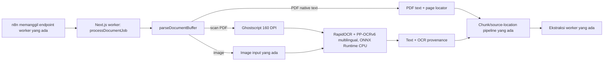

# PRD — Migrasi OCR Worker ke PP-OCRv6 (Bahasa Indonesia + English)

**Status:** Local PP-OCRv6 implementation and parser integration smoke pass on macOS arm64/Python 3.11.16; human-verified quality and resource gates remain open. VPS production deployment is blocked until the actual target specs and quality/resource gates in §8 are recorded and passed.
**Lingkup:** Mengganti OCR lokal Tesseract pada worker untuk scanned PDF dan gambar dengan PP-OCRv6 multilingual melalui RapidOCR dan ONNX Runtime CPU.
**Tujuan produk:** OCR harus membaca konten berbahasa Indonesia dan Inggris, termasuk halaman yang mencampur keduanya, tanpa GPU atau layanan OCR eksternal.

## 1. Ringkasan

Before this migration, the worker used pdf.js for selectable PDF text, Ghostscript to render scanned PDF pages, and Tesseract for images and scanned pages. Tesseract language used `XASS_OCR_LANG`; Indonesian required `ind+eng` traineddata. Local PP-OCRv6 tiny/small benchmark runs showed ONNX Runtime CPU feasibility, but had no human ground truth and did not establish quality at the worker's 160 DPI.

Target yang disetujui adalah mengganti mesin OCR lokal untuk gambar dan halaman PDF scan dengan PP-OCRv6 melalui RapidOCR. Model berjalan lokal di CPU. Tidak ada panggilan LLM, node n8n, fallback Tesseract, atau OCR terhadap XLSX.

PP-OCRv6 is the selected engine. The initial localhost implementation uses `tiny` because the recorded 300 DPI CPU run was faster and returned text on page 5, unlike `small`. Those results contain no human-verified reference, so this is a pilot default, not a quality conclusion or production model-size decision. Compare tiny and small on the human-verified corpus before VPS promotion.

## 2. Keputusan produk

| ID | Keputusan | Dampak |
|---|---|---|
| D01 | OCR baru menggunakan PP-OCRv6 multilingual melalui RapidOCR dan ONNX Runtime CPU. | Satu jalur OCR lokal untuk gambar dan halaman PDF scan. |
| D02 | Bahasa produk yang dijanjikan adalah Indonesia dan English, termasuk teks campuran pada satu halaman. | Coverage harus dibuktikan memakai fixture campuran, bukan hanya dua dokumen monolingual. |
| D03 | Pakai konfigurasi multilingual PP-OCRv6 yang telah diuji pada benchmark (`lang_type="id"` untuk detector dan recognizer); konfigurasi ini bukan deteksi bahasa per halaman. | Jangan mempertahankan `XASS_OCR_LANG=ind+eng` seolah menjadi parameter RapidOCR. Validasi perilaku English dan Indonesia bersamaan sebelum cutover. |
| D04 | Bandingkan PP-OCRv6 tiny dan small dengan kontrol Tesseract `ind+eng` yang dituning pada image identik. Tesseract hanya pembanding evaluasi, bukan fallback runtime. | Satu ukuran PP-OCRv6 dipin setelah quality/resource gate; tidak ada pemilihan model per dokumen. |
| D05 | OCR berjalan pada CPU; CUDA dan CoreML/GPU dinonaktifkan. Thread dan konkurensi dibatasi serta diukur. | Hasil benchmark dan resource worker dapat direproduksi. |
| D06 | Jalur pdf.js, seleksi halaman scan, Ghostscript `-r160`, limit, dan source locator dipertahankan untuk migrasi ini. | Perubahan hasil dapat diatribusikan ke mesin OCR, bukan DPI atau preprocessing. |
| D07 | Kegagalan runtime/model atau OCR tanpa teks pada halaman scan mana pun menggagalkan seluruh parse dokumen. | Tidak menyimpan parse parsial dan tidak pernah melaporkan parse lengkap setelah halaman gagal. |
| D08 | OCR tetap dimiliki worker, berjalan lokal pada CPU, dan tidak memakai layanan eksternal. n8n tetap memanggil worker yang ada. | Tidak ada layanan OCR cloud atau node OCR baru di n8n. |
| D09 | Initial implementation and smoke evaluation run on developer localhost. VPS deployment is not yet specified. | Record the local machine/runtime for pilot results; do not infer VPS capacity. Re-run resource gates on the actual VPS before deployment. |

## 3. Kondisi eksisting dan bukti

### 3.1 Alur baseline sebelum migrasi

1. Endpoint Next.js `/api/workers/parse-document` memanggil `processDocumentJob()`, yang menggunakan `parseDocumentBuffer()`.
2. PDF diproses halaman demi halaman dengan pdf.js. Jika sebuah halaman memiliki teks native, teks itu dipakai. OCR hanya berjalan ketika tidak ada teks native dan operator gambar ditemukan.
3. Halaman scan dirender Ghostscript menjadi PNG berwarna pada 160 DPI, lalu OCR dipanggil. PDF scan dibatasi maksimal 20 halaman; PDF juga dibatasi 200 halaman, 64.000 karakter per halaman, dan 320.000 karakter total.
4. Gambar umum ditulis sementara ke direktori temp, dikenali dengan OCR, lalu temp directory dihapus.
5. Baseline Tesseract ran as a local process, one image per call, with a 120-second timeout and 10 MB output buffer. `XASS_OCR_LANG` defaulted to `eng`; `ind+eng` required Tesseract traineddata.
6. Teks OCR masuk ke jalur normalisasi, paragraph blocks, chunks dan source locators. Lokasi PDF menyimpan nomor halaman; lokasi gambar menyimpan nama gambar.
7. Baseline OCR metadata named `tesseract`; PDFs stored `ocrLanguage`, and block/chunk provenance was hard-coded to `tesseract`.
8. OCR XLSX bukan jalur normal. Parser XLSX membaca isi workbook/OOXML secara terstruktur.

### 3.2 Bukti benchmark PP-OCRv6

- `tools/ocr_benchmark.py` merender halaman sekali pada 300 DPI, memakai input PNG identik, CPU-only, satu thread, dan tanpa preprocessing eksternal. RapidOCR dikonfigurasi dengan route `id`; benchmark menyatakan route multilingual itu mencakup English.
- Pada warm run dokumen 5 halaman, rata-rata tiny adalah sekitar 0,773 detik/halaman dan small sekitar 2,394 detik/halaman. Warm-up/model load diukur terpisah.
- File hasil benchmark yang disimpan (`tools/ocr-benchmark-results*.json`) mencatat lima halaman pada 300 DPI tanpa reference transcript; keduanya menyatakan `ground_truth.provided=false`, sehingga tidak memiliki CER/WER. Tiny mengembalikan judul “Timeline” di halaman 5; small menghasilkan output kosong di halaman itu.
- Draft ini sebelumnya mencatat CER/WER dari perbandingan terhadap transkripsi LLM, tetapi data referensi dan hasil yang dapat direproduksi tidak tersedia di repo. Angka tersebut bukan dasar pemilihan model atau release gate.
- Runner benchmark mendukung Tesseract, tetapi hasil tersimpan melewati Tesseract karena traineddata `ind` tidak tersedia. Karena itu, hasil tersimpan belum menjadi baseline pembanding Tesseract.
- Uji 300 DPI belum membuktikan kualitas pada production render 160 DPI. Tabel padat di halaman 3 juga masih gagal mempertahankan susunan/relasi kolom; migrasi OCR saja tidak membangun ulang tabel.

## 4. Masalah, tujuan, dan non-goals

### 4.1 Masalah

- Tesseract required per-language traineddata; the stored evaluation baseline could not run Indonesian because `ind` traineddata was unavailable on the benchmark machine.
- PP-OCRv6 local integration, pinned model assets, process lifecycle, metadata, and all-or-nothing error handling are implemented. Quality on a human-verified corpus, performance at the worker's 160 DPI, and compatibility with the unspecified VPS remain unproven.
- Penggantian engine dapat merusak source provenance atau menyatakan dokumen berhasil walau OCR tidak membaca halaman.
- Kualitas OCR saat ini belum dinilai memakai ground truth manusia dan kondisi DPI worker.

### 4.2 Tujuan

1. Mendukung OCR lokal Bahasa Indonesia dan English untuk format gambar yang sudah didukung serta halaman PDF scan yang sudah dirutekan ke OCR.
2. Mempertahankan output plain text, urutan baca terbaik yang tersedia, page/image locator, parser limits, warning, dan error semantics.
3. Menjalankan PP-OCRv6 di CPU dengan model/runtime/version yang dipin, tanpa download model saat request.
4. Memilih tiny atau small berdasarkan evaluasi teks, kegagalan halaman, waktu dan peak memory pada target deployment.
5. Memastikan Tesseract tidak dibutuhkan untuk jalur runtime setelah cutover.

### 4.3 Non-goals

- Mengubah parsing PDF native-text, OCR mixed page yang sudah memiliki sebagian teks native, atau strategi deteksi halaman scan.
- Mengubah raster DPI, deskew, binarisasi, crop, orientasi, image enhancement, atau preprocessing pada migrasi pertama.
- Membangun ulang tabel PDF menjadi cell/header/row structure; OCR hanya menghasilkan teks dan layout reading order yang tersedia dari engine.
- Mengubah parser XLSX, DOCX, PPTX, atau CSV/TXT; menambahkan OCR ke spreadsheet.
- Membuat OCR/LLM node baru di n8n, memanggil model vision/LLM, mengirim dokumen ke cloud, atau melatih model sendiri.
- Menambah fallback Tesseract, model router berdasarkan confidence, atau pemilihan tiny/small per dokumen.
- Mengubah UI/review workflow selain memakai error/warning yang sudah ada.

## 5. Pengguna dan kebutuhan

| Aktor | Kebutuhan |
|---|---|
| Uploader/reviewer | Dokumen scan Indonesia, English, atau campuran dapat diproses; kegagalan OCR terlihat sebagai kegagalan/review, bukan dokumen kosong yang sukses. |
| Worker | Menerima teks OCR dan source locator tanpa perubahan kontrak ekstraksi/chunking yang tidak diperlukan. |
| Operator | Mengetahui model, ukuran, runtime dan versi yang dipakai; memverifikasi CPU, memory, cold-start, dan offline availability. |
| QA/product owner | Menilai akurasi menggunakan transcript human-verified dan menetapkan quality/resource gate sebelum rollout. |

## 6. Alur dan kepemilikan

- `n8n` tetap menjalankan orchestration job; tidak mengirim teks ke OCR langsung.
- Node worker tetap menjadi pemilik file parsing, halaman, temp files, errors, dan provenance.
- Current implementation uses one local Python helper per document batch; RapidOCR initializes exactly once and processes every OCR page in that document. Do not launch a new interpreter or load the model per page. A long-lived service is a future operational choice only if measured startup cost warrants it.
- Local Python/ONNX CPU feasibility is verified. Before deployment, verify the actual VPS runtime, model packaging, process lifecycle, and resource limits; do not infer VPS capacity from localhost.

## 7. Functional requirements

### FR-01 — Dukungan bahasa

- Sistem **MUST** mengolah halaman Indonesia dan English dengan PP-OCRv6 multilingual yang dipin.
- Sistem **MUST** diuji pada kalimat/halaman campuran kedua bahasa. Daftar bahasa yang didukung model bukan bukti bahwa satu halaman campuran terbaca dengan baik.
- Implementasi **MUST** memakai route resmi RapidOCR yang didokumentasikan dan diuji. Pada benchmark yang ada route `id` dipakai untuk detector dan recognizer; jangan mengarang route `id+en` bila API tidak mendukungnya.
- Metadata **MUST** membedakan route konfigurasi dari bahasa yang terdeteksi. OCR tidak boleh mengklaim bahwa halaman berbahasa tertentu hanya dari parameter route.

### FR-02 — Cakupan input

- Gambar yang saat ini didukung dan halaman PDF scan yang lolos kondisi OCR saat ini **MUST** memakai engine baru.
- PDF dengan teks native **MUST** tetap menggunakan ekstraksi pdf.js tanpa OCR tambahan.
- Batas 20 halaman scan/PDF, page count, text length, dan cleanup temp files **MUST** tetap berlaku.
- XLSX **MUST NOT** dirasterisasi/OCR untuk parsing normal.

### FR-03 — Kontrak hasil dan provenance

- Adapter OCR **MUST** mengembalikan teks hasil OCR atau error yang dapat diklasifikasikan; response kosong tidak boleh dianggap hasil sukses.
- Hasil teks **MUST** menjaga urutan baca yang dikembalikan engine sejauh tersedia dan mempertahankan line breaks yang diperlukan downstream. Output tetap plain text; table reconstruction di luar lingkup.
- `sourceLocation` **MUST** tetap menyimpan `pageNumber` untuk PDF dan `imageName` untuk gambar.
- Metadata hasil **MUST** menyebut engine `rapidocr`, model `PP-OCRv6`, ukuran model yang dipin, runtime `onnxruntime-cpu`, route konfigurasi, dan versi/artifact model. Metadata **MUST NOT** menamai Tesseract sebagai engine baru atau menyebut route sebagai bahasa yang berhasil dideteksi.
- `PARSER_VERSION` **MUST** dinaikkan untuk migrasi; versi package/model OCR dan hash artifact dicatat terpisah. Metadata historis tidak diubah.
- PDF tetap melaporkan `pdfjs-dist` sebagai parser PDF; OCR dicatat sebagai metadata OCR halaman, bukan mengganti identitas parser native PDF.
- Confidence OCR, bila disimpan, **MUST NOT** disajikan sebagai akurasi atau probabilitas terkalibrasi.

### FR-04 — Model/runtime CPU lokal

- Inference **MUST** berjalan tanpa CUDA, CoreML, GPU, koneksi jaringan, atau API berbayar. Baseline benchmark saat ini memakai ONNX Runtime, CUDA/CoreML nonaktif, dan satu thread intra/inter-op.
- Versi RapidOCR, ONNX Runtime, model type, route, dan file model **MUST** dipin; checksum/hash artifact **MUST** diverifikasi pada build/deployment.
- Model assets **MUST** tersedia sebelum menerima job. Request **MUST NOT** mengunduh model dari internet atau diam-diam menggunakan model/language lain.
- Proses OCR **MUST** memakai memory, timeout, dan concurrency yang dibatasi. Target peak memory dan latency numerik harus disepakati terhadap deployment CPU yang nyata sebelum release.

### FR-05 — Error dan kegagalan

- Runtime tidak tersedia, model tidak ada/gagal dimuat, inference timeout, input image tidak dapat dibaca, dan OCR tanpa teks **MUST** tetap menghasilkan error yang eksplisit dan actionable.
- Halaman scan yang gagal OCR **MUST NOT** disimpan sebagai parse lengkap dengan teks kosong. Tidak ada fallback ke Tesseract atau engine lain pada request yang sama.
- Any OCR failure on a scanned page **MUST** fail the entire document through the existing `failed` job contract; no partial chunks are persisted.
- Error `ocr_language_unavailable` khusus traineddata Tesseract **SHOULD** dihapus setelah migration; pesan/README harus menjelaskan kebutuhan runtime/model PP-OCRv6, bukan file `ind`.

### FR-06 — Cutover dan konfigurasi

- `XASS_OCR_LANG` **MUST** dihapus dari runtime worker setelah transisi karena parameter `eng`/`ind+eng` adalah konfigurasi Tesseract, bukan kontrak bahasa PP-OCRv6.
- Ukuran model **MUST** dipin pada deployment, bukan bisa dipilih uploader. Tidak boleh ada fallback/alias kompatibilitas Tesseract di kode produksi.
- `worker/README.md`, test setup, deployment checklist, parser metadata, dan error messages **MUST** diperbarui bersama implementasi.

## 8. Quality, acceptance criteria, dan release gates

### 8.1 Human-verified corpus and quality

- Release **MUST NOT** menggunakan transkripsi LLM sebagai reference formal. Buat corpus human-verified yang memiliki izin penggunaan, halaman/lokasi sumber, dan dapat direproduksi.
- Corpus **MUST** mengandung halaman Indonesia, English, campuran, teks kecil/low-contrast, angka/tanggal/identifier, halaman sparse yang hanya berisi judul, serta halaman tabel sebagai kasus negatif/diagnostik.
- Bandingkan model pada image yang identik, CPU, resolusi sama, tanpa preprocessing luar. Uji pada 160 DPI production dahulu; 300 DPI boleh diuji terpisah sebagai ablation, bukan perubahan tersembunyi dalam migrasi.
- Laporkan CER/WER per bahasa, per halaman dan dokumen, exact match untuk identifier/tanggal/angka penting, halaman kosong/missed-text, dan reading-order errors. OCR confidence tidak menggantikan transcript.
- Sebelum held-out evaluation, product/QA **MUST** menetapkan ambang numerik kualitas dan resource. Ambang dibekukan sebelum hasil held-out dibuka.
- PP-OCRv6 **MUST** memenuhi ambang pada halaman Indonesia dan campuran, tanpa regresi material pada English atau critical OCR fields dibanding kontrol Tesseract yang disepakati. Halaman berteks tidak boleh menghasilkan output kosong secara diam-diam.
- Tesseract `ind+eng` yang dituning **MUST** diuji hanya sebagai kontrol evaluasi pada image, DPI, dan batas CPU yang sama; traineddata yang tidak tersedia membatalkan perbandingan, bukan mengaktifkan fallback runtime.

### 8.2 Functional acceptance

| ID | Given / When | Then |
|---|---|---|
| AC-01 | Gambar scan berisi teks Indonesia | Output memuat teks yang lolos ambang kualitas; source locator menyimpan nama gambar; metadata menyebut PP-OCRv6 dan CPU runtime. |
| AC-02 | Gambar/halaman scan berisi English | English dikenali pada route multilingual yang dipilih; tidak perlu traineddata Tesseract `eng`. |
| AC-03 | Satu halaman mencampur Indonesia dan English | Kedua bahasa dievaluasi terhadap human gold dan lolos ambang kualitas yang ditetapkan; tidak menjalankan router berdasar ground truth. |
| AC-04 | PDF memiliki teks native | pdf.js tetap memproses halaman tanpa pemanggilan OCR tambahan. |
| AC-05 | Scanned PDF berisi beberapa halaman | Setiap chunk OCR menyertakan nomor halaman yang benar; warning menyatakan OCR digunakan. |
| AC-06 | Satu halaman scan tidak terbaca, OCR mengembalikan teks kosong, atau model gagal | Seluruh dokumen gagal diparse; tidak ada chunk parsial yang disimpan dan tidak ada sukses seolah dokumen lengkap. |
| AC-07 | Model/runtime tidak tersedia atau belum dipaketkan | Health/startup check atau job gagal eksplisit; tidak ada download atau fallback diam-diam. |
| AC-08 | CPU resource benchmark is run on the localhost pilot | Model runs CPU-only with bounded threads/concurrency and records latency/peak RSS; this does not qualify a VPS. Repeat the resource gate after actual VPS specs are recorded. |
| AC-09 | PDF melebihi batas scan/text yang ada | Batas tetap ditegakkan; tidak ada truncation atau resource expansion diam-diam. |
| AC-10 | XLSX berisi banyak sheet | Jalur OOXML yang ada tidak berubah dan tidak mengubah sheet menjadi gambar/OCR. |

### 8.3 Resource gate

Measure cold-start/model load, warm latency p50/p95 per page, time for a 20-page document, peak RSS, artifact size, CPU utilization, and throughput at realistic concurrency. Record OS, CPU, package versions, model hash, DPI, thread count, cache state, and local pilot results. VPS CPU/RAM/concurrency are unknown; measure them and repeat this gate on the actual target before rollout.

## 9. Implementation status and remaining work

| Workstream | Pemilik yang disarankan | Status / deliverable |
|---|---|---|
| Feasibility runtime | Worker/platform | Local Python + ONNX Runtime CPU and pinned assets verified. Verify target OS/runtime, offline model availability, process lifecycle, and resource limits when VPS specs exist. |
| Evaluasi gold set | QA + product/domain reviewer | Pending: permission-cleared human-verified transcripts, language/difficulty strata, and frozen numeric quality/resource thresholds. |
| Integrasi OCR | Worker/backend | Completed: image/scanned-PDF flows use `recognizeImages()` and a RapidOCR PP-OCRv6 helper, one engine per document batch, bounded timeout/output, and existing temp cleanup/source order. |
| Parser contract | Worker/backend | Completed: image/PDF provenance, parser metadata, route/model version, warning/error mapping, and Tesseract-specific runtime configuration updated. |
| Dependency dan model pinning | Platform/DevOps | RapidOCR/ONNX Runtime and model hashes pinned; verify licenses before release. Requests do not download model assets. |
| Regression dan runtime smoke | QA + worker | Local integration smoke passed for generated bilingual image/scanned-PDF fixtures, page locators, all-or-nothing blank scan, and unavailable assets. Human-corpus quality and resource benchmarks remain pending. |
| Dokumentasi/cutover | Worker/platform | Local setup instructions updated; deployment handoff and rollback checklist remain before production. |

## 10. Tahap implementasi dan rollout

1. **Local implementation:** complete on localhost with pinned RapidOCR/ONNX CPU dependencies and preinstalled model assets; requests do not download models.
2. **Local smoke:** passed on macOS arm64 with Python 3.11.16, RapidOCR 3.10.0, ONNX Runtime CPU 1.31.0, and PP-OCRv6 tiny. Generated Indonesian/English text passed through image and scanned-PDF paths; empty scanned pages fail the whole document, and missing assets fail explicitly. This synthetic smoke does not establish corpus quality, resource capacity, or VPS readiness.
3. **Quality gate:** create the human-verified corpus; compare tiny/small and the Tesseract evaluation control at the worker's 160 DPI using identical page images. Product/QA freezes numeric thresholds before held-out evaluation.
4. **VPS feasibility:** document the actual VPS OS, CPU, RAM, concurrency, Python/ONNX support, and model packaging. Repeat resource acceptance there; unknown VPS specs remain a deployment blocker, not a reason to assume local results transfer.
5. **Promotion:** stage/canary only after quality and VPS resource gates pass. Rollback restores the prior worker release; the new runtime has no Tesseract fallback.

## 11. Risiko dan mitigasi

| Risiko | Mitigasi |
|---|---|
| Route `id` dipahami keliru sebagai bahasa terdeteksi atau tidak membaca English campuran | Catat route terpisah dari supported languages; uji mixed-language gold fixture sebelum cutover. |
| PP-OCRv6 small miss pada halaman sparse | Sertakan halaman judul/sparse pada gold set; no silent empty success; bandingkan tiny/small sebelum menentukan model. |
| Python/ONNX Runtime cannot run on the future VPS worker | Localhost proves only local feasibility; verify the actual VPS OS/runtime, offline model availability, process lifecycle, and resource limits before deployment. |
| Model diunduh saat request pertama atau internet tidak tersedia | Paketkan model, pin/hash artifacts, lakukan readiness check sebelum job. |
| Model runtime terbuka satu salinan per halaman/job dan menghabiskan RAM | Reuse engine antarpages; batasi concurrency dan ukur peak RSS pada concurrency nyata. |
| OCR text order berbeda pada tabel | Tetap tandai OCR sebagai text transcription; tabel reconstruction tidak termasuk; gunakan review/limit downstream claims. |
| Render 300 DPI benchmark berbeda dengan 160 DPI worker | Gate memakai production 160 DPI; perubahan DPI dinilai terpisah dan tidak dicampur dengan migrasi model. |
| Metadata lama masih menyebut Tesseract atau nilai `ocrLanguage` ditafsir sebagai hasil deteksi | Perbarui kontrak untuk dokumen baru; metadata historis tidak ditulis ulang; gunakan field engine/model/route/supported languages yang eksplisit. |
| Model/license tidak sesuai distribusi | Verifikasi lisensi model assets dan dependency sebelum image release. |

## 12. Dependencies dan keputusan sebelum produksi

- VPS target specs (OS, CPU, RAM, concurrency, and Python/ONNX support) are not known. Capture them in the deployment handoff and rerun the resource gate before deployment; localhost results are only a pilot.
- Human-verified bilingual corpus dan quality gates harus tersedia sebelum klaim peningkatan akurasi.
- Tiny dan small dievaluasi pada corpus yang sama; tidak ada ukuran model final sebelum quality/resource gate. Hasil lama tidak menetapkan pemenang.
- Local pilot pins Python 3.11, RapidOCR 3.10.0, and ONNX Runtime CPU 1.31.0. PP-OCRv6 tiny detector/recognizer SHA-256: `f42c0fbd294d95eac1a550e131b277dac97462c8025fa4b6c3cec1b7894bd3d5` / `e16e242de5937ad92609223f19bc2aff3727ee40b095f996907c24749bad251b`; PP-OCRv4 orientation classifier SHA-256: `e47acedf663230f8863ff1ab0e64dd2d82b838fceb5957146dab185a89d6215c`. Setup prefetches/verifies assets; requests do not download models.
- Local OCR runs one batch helper process per document and initializes PP-OCRv6 once for all OCR pages in that document. Do not launch or reload the model per page. A long-lived service is a later operational choice only if measured document-level startup cost requires it.

## 13. Sumber dan bukti

### Repository

- OCR parser, PDF scan gate, Ghostscript `-r160`, Tesseract invocation/timeouts, metadata, errors dan limits: [`worker/src/services/document-parser.ts`](../../worker/src/services/document-parser.ts).
- Instruksi runtime worker saat ini: [`worker/README.md`](../../worker/README.md).
- OCR integration smoke tests saat ini: [`tests/integration/phase6-document-parser.test.mjs`](../../tests/integration/phase6-document-parser.test.mjs).
- Benchmark candidate setup, route `id`, CPU-only/1 thread, raster 300 DPI: [`tools/ocr_benchmark.py`](../../tools/ocr_benchmark.py).
- Warm benchmark outputs (tidak berisi human ground truth): [`tools/ocr-benchmark-results-warm.json`](../../tools/ocr-benchmark-results-warm.json).
- Shortlist riset OCR CPU dan catatan batas perbandingan vendor: [`ocr-model-research.md`](ocr-model-research.md).

### Dokumentasi resmi

- RapidOCR, [PP-OCRv6 model routing dan daftar bahasa](https://rapidai.github.io/RapidOCRDocs/main/model_list/): model tiny/small, route `id` dan `en`, ONNX Runtime, konfigurasi per model.
- RapidOCR, [repository resmi](https://github.com/RapidAI/RapidOCR): runtime/integrasi dan deployment offline.
- ONNX Runtime, [Python CPU installation](https://onnxruntime.ai/docs/get-started/with-python): paket `onnxruntime` untuk CPU termasuk macOS dan CPU ARM.
